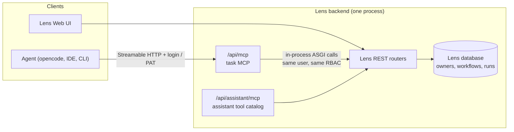

# MCP Agent Task Tools Design

> The task MCP is the agent-facing tool surface of Lens, served at `POST /api/mcp` (code in
> `apps/backend/src/llm_d_lens/mcp/`). It is a small, hand-written set of task tools that lets a coding or
> operations agent run the prefill/decode (PD) experiment loop on Lens: check capacity, plan, deploy, verify,
> benchmark, collect data, compare and clean up. It is part of the Lens backend process: it shares Lens
> identity, ids, ownership and REST routes with the Web UI and holds no state of its own.

## 1. Goals and non-goals

**Goals**

1. An agent can run the whole PD experiment loop (§4) with task tools only, using Lens concepts and Lens ids.
2. Fire-and-forget: start tools return a Lens id and a poll hint, and progress never depends on polling.
   Blocking waits are explicit, bounded and opt-in.
3. The Web UI and the MCP read and write the same Lens data. Whatever an agent starts is visible in the Web UI
   and the reverse.
4. A write never touches a deployment, experiment or Model Service the caller does not own (§8); other kinds
   follow Lens permissions.
5. The MCP layer holds no state. Restarting Lens loses nothing.
6. The default surface is small: only the `core` profile is offered unless an operator enables more (§3.4).

**Non-goals**

- Replacing the assistant tool catalog at `/api/assistant/mcp`, which keeps serving the Lens Assistant and the
  agentic planner (§3.3).
- A queue or scheduler for experiments across users. Capacity is checked at start time and `placement_probe`
  is advisory.
- Kubernetes access outside Lens REST.
- Benchmarking an already running deployment outside an Evaluation workflow, and anything involving model
  access tokens (service tokens are created in the Lens UI only).
- Hiding Lens limits. Where Lens cannot express something (for example interleaving cases across plans), the
  tool reports it.

## 2. Design principles

1. **Lens-native concepts and ids.** Tools return Lens entities with Lens ids: deployment run or execution,
   evaluation workflow and case, benchmark run, Model Service group, storage volume, model cache entry,
   simulation task, configuration artifact. There are no tool-specific id prefixes or aliases.
2. **One field vocabulary.** Topology and runtime inputs are the camelCase guide-planning fields
   (`GuidePlanFields`); benchmark inputs are the snake_case Lens evaluation models. The mixed casing is a Lens
   fact and is passed through.
3. **Stateless.** Every value a tool returns can be recomputed from Lens. There are no local files, tables,
   caches, leases, idempotency keys or plan stores.
4. **Lens owns long-running state.** A long-running task is a Lens resource (deployment run, evaluation
   workflow, benchmark run, simulation task) that Lens advances whether or not an agent is watching. Start
   tools return `{id, status, poll_after_seconds, next}` and exit.
5. **Bounded, opt-in waits.** Only `<resource>_get` style read tools accept `wait_seconds`, with a documented
   ceiling (§9.3).
6. **Summary first.** Compact summaries (status, counts, the one active item, timestamps, warnings) with
   detail behind an `include` enum. Errors carry a stable `code`, the offending `field` and a `hint` naming the
   next tool.
7. **Ownership comes from Lens.** The owner is what Lens records and reports (`owner_user_id`, `ownership`,
   `capabilities`), not something the MCP infers (§8).
8. **Direct code paths.** The main flow is straight line; a branch exists only for a real requirement.
9. **Task tools are thin compositions of Lens REST.** A tool adds summaries, validation and next-step hints. It
   does not re-implement Lens logic; where a capability is missing it is added to Lens REST, so the Web UI and
   the MCP use the same feature (§10).

## 3. Architecture

### 3.1 Placement and transport



`/api/mcp` is a stateless Streamable HTTP route: each request builds an ephemeral MCP server, there is no
`Mcp-Session-Id`, and `GET` and `DELETE` return 405. Each tool call makes in-process ASGI calls
(`AsgiLensApi`) that forward the caller's cookie or `Authorization` header and mark the request source as
`assistant`. The task layer imports no Lens services, DAOs or Kubernetes clients; it is an ordinary client of
Lens REST, bounded by Lens validation and RBAC. There is no second transport and no credential of its own.

### 3.2 Identity and authentication

- The caller is whoever Lens authenticates: a browser session or a personal access token (PAT,
  `lens-pat-*`; see [Auth and RBAC design](auth-rbac-design.md)). The principal id comes from
  `GET /api/v1/auth/session` once per call.
- The route requires the permission `mcp:tool:invoke` or `playground:chat:use`. Lens resolves permissions per
  request (`auth/policy.py`); the task layer never elevates and never retries a 403 with other credentials.
- The recommended agent identity is a per-person, non-admin Lens account bound as cluster maintainer. Global
  administrators bypass record-level checks, so running an agent as one turns a mistake into a cluster-wide
  one.

### 3.3 Relationship to the assistant tool catalog

Lens also has a generated assistant tool catalog (`/api/assistant/mcp`, package `llm_d_lens.assistant_tools`;
see [MCP tools and Playground design](mcp-playground-design.md)) with one tool per REST operation. It is
complete but low level.

| Aspect | Assistant tool catalog (`/api/assistant/mcp`) | Task MCP (`/api/mcp`) |
| --- | --- | --- |
| Granularity | One tool per REST operation | One tool per task (46) |
| Output | Raw REST payloads | Summaries, derived progress, warnings, hints |
| Waiting | `wait_for_status` polls a read tool | `wait_seconds` inside `<resource>_get`, bounded |
| State | None | None |
| Intended client | Lens Assistant and the agentic planner (internal) | Coding and operations agents running multi-step workflows |

Both share routes, RBAC and the `assistant` source tag.

### 3.4 Profiles

Tools are grouped in profiles. `LENS_MCP_PROFILES` (comma-separated, default `core`; `core` is always on)
decides which profiles the server lists and accepts; a call to a tool of a disabled profile returns
`scope_required`. The variable is a deployment setting of the Lens instance, not a per-user or per-resource
setting. Lens permissions are checked again on every call by the REST route the tool uses, so enabling a
profile never grants more than the caller's Lens role. `cluster_list` reports which profiles the connection
has.

| Profile | Tools | Default |
| --- | --- | --- |
| `core` | 23 | yes |
| `serving` | 6 | no |
| `storage` | 3 | no |
| `simulation` | 5 | no |
| `lens-settings` | 2 | no |
| `cluster-admin` | 7 | no |
| Total | 46 | |

`cluster-admin` changes shared infrastructure and stays out of the default.

## 4. What the PD experiment workflow needs

This table is the reason for the surface in §5. Each step names the tool that serves it.

| Step | What the person needs | Tools |
| --- | --- | --- |
| 1. Model and cache | Is the model cached on the model volume; fit per tensor-parallel size | `model_search`, `model_get`, `model_cache_create` |
| 2. Capacity and placement | Do the P/D roles fit now as whole PCIe roots with a NIC on one node; free roots per node | `cluster_get(include=["topology"])`, `placement_probe` |
| 3. Plan | What Lens would deploy for one topology or a whole matrix: GPUs, image, warnings | `guide_list`, `deployment_plan`, `experiment_plan` |
| 4. Deploy and verify | Start, watch, diagnose, smoke test, stop | `deployment_create`, `deployment_get`, `deployment_diagnose`, `deployment_logs`, `deployment_test`, `deployment_stop` |
| 5. Run the matrix | Several topologies and workloads, repetitions, randomized order, baselines | `experiment_plan`, `experiment_start`, `experiment_get`, `experiment_cancel`, `experiment_retry` |
| 6. Collect data | Metrics per stage, per-request lifecycle records, quality of the run | `experiment_get(include=["results"])`, `experiment_artifact_get` |
| 7. Compare | Same plan across experiments, deltas against a baseline, medians over repetitions | `result_compare` |
| 8. Clean up | Remove what I created and nothing else | `resource_list`, `resource_delete` |

The agent's loop is therefore stateless primitives: `placement_probe` → `experiment_plan` →
`experiment_start` → `experiment_get` (poll) → `experiment_artifact_get` → `result_compare` →
`resource_delete`. The state of an active experiment is the Lens Evaluation workflow; the MCP only reads and
starts it.

## 5. Tool catalog

The published tool descriptions and input schemas (`tools/list`) are the reference for exact inputs. This
section records the design: what each tool composes and the rules it follows.

### 5.1 Conventions

- **Risk tiers.** Each description starts with a tier: `[R]` read only; `[W]` writes a record, sends requests or
  runs a short job but starts no model workload; `[S]` starts something that uses cluster resources; `[D]`
  deletes or interrupts; cluster-administration tools are `[D]` or `[W]` and are in their own profile. `[R]`
  sets `readOnlyHint`, `[D]` sets `destructiveHint`; `openWorldHint` is set only for tools that reach outside
  Lens and the cluster (Hugging Face, AI providers, guide sources).
- **Names.** `<resource>_<verb>`, so related tools sort together. Verbs: `list`, `get`, `plan`, `create`,
  `start`, `stop`, `cancel`, `retry`, `delete`, `test`, `scan`, `check`. Exceptions that read better as nouns:
  `deployment_logs`, `result_compare`.
- **Ids.** Lens ids only. `deployment_id` is a deployment run id (an execution id is also accepted).
  `experiment_id` is an evaluation workflow id.
- **Long-running results.** Start tools and long-running `get` tools return Lens `status` verbatim, plus
  `poll_after_seconds` and `next`.
- **Enums.** Every closed set is a JSON Schema `enum`.
- **Side-effect line.** Every description ends with a `Side effects` line stating side effects, resources,
  duration and reversibility.
- **Plans are pure reads.** `deployment_plan` and `experiment_plan` create nothing; the matching start tool
  re-plans and compares a digest (§5.3).

### 5.2 Shared input: `GuidePlanFields`

`deployment_plan`, `deployment_create` (as `configuration`) and `experiment_plan` / `experiment_start` (as
`common` and `variants[].plan`) take the guide-planning request fields read by `deploy/guide_planning.py`:

| Field | Type | Notes |
| --- | --- | --- |
| `guide`, `guideVariant`, `accelerator`, `modelServer` | string | Catalog ids; `accelerator` may be omitted when the catalog offers exactly one; `modelServer` defaults to `vllm`. |
| `model` | string | Hugging Face model id. |
| `replicas`, `tensorParallelSize` | integer | Non-PD topology. For `pd-disaggregation` they alias `decodeReplicas` and `decodeTensorParallelSize`, matching the UI. |
| `prefillReplicas`, `prefillTensorParallelSize`, `decodeReplicas`, `decodeTensorParallelSize` | integer | PD roles; only `pd-disaggregation` has them. |
| `maxModelLen`, `maxNumSeqs`, `gpuMemoryUtilization`, `blockSize`, `maxNumBatchedTokens` | number | vLLM runtime parameters. |
| `customParameters` | list | `[{target, kind, name, value}]`, passed through. |
| `runtimeImage` | string | Optional; Lens resolves it from the hardware profile. |
| `modelSource`, `modelPath`, `modelPvcClaimName` | string | Model location, passed through. `modelPath` is an absolute worker-node path and implies `modelSource: "shared-path"`. |
| `guideSettings` | object | `rdmaNicCount`, `cacheCpuGiB`, `routerValues`. |
| `source` | object | `official` (default, the cluster's pinned source), `local` (a path on the Lens host under `PRISM_GUIDE_LOCAL_ROOTS`) or `remote` (a GitHub repository path and ref that Lens resolves to a commit). |
| `customPatches` | list | At most 20 resource YAML patches (256 KiB each) that Lens merges after planning. |

The task layer fills the defaults the UI fills (`modelServer`, the only `accelerator`, `clusterSessionId`,
`environment`) and applies the PD aliasing. It returns `field_conflict` when an alias and its target disagree,
`field_not_applicable` when PD fields are sent for a non-PD guide, and `missing_field` when `guide`, `model`
or a PD role field is absent. Everything else goes to Lens unchanged and Lens validation errors keep their
field paths. Plans report the resolved `source` and `applied_custom_patches`.

### 5.3 Discovery, capacity and catalog (`core`)

| Tool | Purpose | Composes |
| --- | --- | --- |
| `cluster_list` | Clusters the caller can use, free and total accelerators, the caller's running deployments, the profiles this connection has | cluster list, session and overview routes |
| `cluster_get` | Readiness and inventory of one cluster; `include` enum `capacity, nodes, topology, readiness, usage, storage, gateway` | overview, CRDs, LeaderWorkerSet, Kubernetes version, gateway status, `GET /api/cluster/clusters/{id}/topology` |
| `placement_probe` | Can this P/D topology be placed now (§7) | `POST /api/cluster/clusters/{id}/placement/probe` |
| `guide_list` | Guide catalog, supported accelerators, model servers and variants, typed parameters of one guide | guide-planning catalog, hardware capabilities |
| `model_search` | Hugging Face search with cache state per candidate | Hugging Face search, model cache entries |
| `model_get` | Model facts, fit per tensor-parallel size, cache state and download estimate; `include` enum `facts, fit, cache, storage, readme` | Hugging Face model, `POST /api/v1/capacity/estimate`, cache entries |
| `model_cache_create` | Download a model into a model-storage volume; idempotent | create or retry model cache entry |

### 5.4 Deployments (`core`)

| Tool | Purpose | Composes |
| --- | --- | --- |
| `deployment_plan` | Pure read: what Lens would deploy. Input is exactly one of `configuration` (`GuidePlanFields`) or `from_deployment_id` (copy of a visible deployment with its exact Lens configuration and storage binding). Returns validity, accelerators, resolved image, deduplicated warnings and a `digest` | `POST /api/guide-planning/plan`, render |
| `deployment_create` | Create a deployment run as the UI does; `expected_digest` guards against a changed plan | plan, `POST /api/deployments/runs` |
| `deployment_get` | Run, case and execution state with per-role pod readiness; `include` enum `verifications`; `wait_seconds` | run, execution, execution pods |
| `deployment_stop` | Scale to zero to free accelerators; keeps record, namespace and configuration | cancel run while creating, stop case once ready |
| `deployment_diagnose` | Rule-based diagnosis with evidence and hints | execution, pods, scheduler events, logs |
| `deployment_test` | Persisted Lens verification task (§5.4.1) | verification task routes |
| `deployment_logs` | Pod logs by role, pod and container; capped and marked untrusted | pod logs |

`deployment_plan` has one form: validate a topology. Recommending a topology for a model is a separate need;
`placement_probe` and `model_get(include=["fit"])` answer its capacity half.

`deployment_create` re-plans, compares the result with `expected_digest` and returns `plan_stale` on a
mismatch. The digest is a SHA-256 over the normalized input, the fields Lens returned (image, accelerator
counts) and the rendered configuration with its guide source, with the deployment name masked so a generated name
does not change it; a guide or render change that leaves the inputs equal therefore also yields `plan_stale`.
Nothing is stored between the two calls. A deployment is modified by stopping it and
creating a copy (`from_deployment_id`); there is no in-place update or restart.

#### 5.4.1 Deployment verification

`deployment_test` starts a Lens-owned persisted verification task on a deployment the caller created (reading
an existing task needs no ownership) and returns `verification_id`, task
`status` and, when finished, a separate `verdict` (`pass`, `fail`, `inconclusive`) with per-check evidence.
Supported checks are `chat` and `prefix_cache`; transfer, routing and rank verification are unsupported
because Lens has no request-attributed counters. `requests` is the total limit (1 to 20) and each request asks
for at most 16 output tokens. `wait_seconds` (0 to 25, default 25) bounds waiting; passing the same
`verification_id` reads the task without sending more requests, and `deployment_get(include=["verifications"])`
lists saved tasks, including when the response to a creation request was lost. Requests are never replayed
and no model text is retained. The Web deployment details page starts and shows the same tasks.

### 5.5 Experiments (`core`)

Lifecycle and request building are in §6.

| Tool | Purpose | Composes |
| --- | --- | --- |
| `experiment_plan` | Dry run of an Evaluation from an `ExperimentDesign` (§6.2): per plan topology, GPUs, image; `case_order`; `cases_total` with `cases_breakdown`; `peak_gpus`; `eta_seconds`; `fits_now`; warnings; `request_digest` | guide plan and render per variant, benchmark timing estimate |
| `experiment_start` | Create the Evaluation workflow; `expected_digest` guards against a changed plan | the above, save configuration artifact per variant, create evaluation |
| `experiment_get` | Status, progress, active case, stale verdict, ETA, quality; `include` enum `cases, results, comparison, points, timeline`; `wait_seconds` (0 to 50), `wait_for` | workflow, benchmark run, deployment run; workflow details only when results are requested |
| `experiment_artifact_get` | List the native benchmark reports of a case, or read one with summary statistics and the Lens download path | run artifacts routes (§10) |
| `experiment_cancel` | Cancel a workflow or some cases | cancel workflow, cancel case |
| `experiment_retry` | Requeue failed or cancelled cases | retry workflow |
| `result_compare` | Compare plans across experiments and standalone benchmark runs: median, min, max, delta versus a baseline, SLA verdicts | workflow details, benchmark runs |

`quality` in `experiment_get` makes a result usable without trust: per scenario, success rate, requests
expected and completed, missing metrics, and warnings (for example a baseline that did not run). It is derived
from the per-case counters Lens already persists. A run with low quality is reported, not hidden; deciding
whether to discard it is the agent's or person's call.

### 5.6 Resources (`core`)

| Tool | Purpose |
| --- | --- |
| `resource_list` | What the caller has across kinds `deployment`, `experiment`, `model_cache`, `storage_volume`, `model_service`, `simulation`, with status and `ownership` (`owned`, `shared`, `unknown`, `unrecorded`; §8.1). `owner` is `me` (default) or `all` |
| `resource_delete` | Delete explicitly listed resources |

`resource_delete` takes `items[{kind, id, name}]` (1 to 20) and requires the caller to echo each target's name
from `resource_list`; a mismatch refuses the whole call before anything is deleted, which replaces any lease
or rate-limit buffer. It reports per item `deleted`, `blocked` (still in use; Lens's in-use guard blocks
active evaluations and published Model Service members), `not_found` or `failed`; one failure does not stop
the others. It lists cascaded deletions (an experiment takes its preserved deployments, benchmark history and
the configuration artifacts it saved with it) and, for storage volumes, never deletes model files: it passes
`keep_model_files=true` unconditionally. Deployments are deleted through the run, never through
`delete_deployment_execution` with `delete_namespace=false`, which leaves workloads running.

### 5.7 Other profiles

| Profile | Tools |
| --- | --- |
| `serving` | `model_service_publish` (publish ready deployments of one model as an endpoint behind the managed gateway), `model_service_get` (endpoint, members, health, `version`; optional `access`, `access_options`, `usage`, `connection`), `model_service_test` (control-plane checks plus up to 5 requests when the server environment holds a service token), `model_service_update` (members, weights, selection policy, description, enable or disable, guarded by `expected_version`), `model_service_access_grant`, `model_service_access_revoke` |
| `storage` | `storage_volume_create` (`local-disk` or `nfs`; local paths only under operator-configured prefixes), `storage_volume_get` (status, capacity, node coverage, models), `storage_volume_scan` (register models copied onto the volume, confirm new nodes) |
| `simulation` | `trace_dataset_list`, `trace_dataset_prepare`, `simulation_start` (only the caller's own deployment, one replay per deployment, checked against Lens's task list), `simulation_get`, `simulation_cancel` |
| `lens-settings` | `ai_provider_list`, `ai_provider_test` (reaches an external service) |
| `cluster-admin` | `cluster_component_check` (read installation status and preflight), `cluster_component_install` (CRDs, LeaderWorkerSet, monitoring, accelerator monitoring, model gateway at the versions Lens pins; accelerator drivers are never installed), `image_prepull`, `model_gateway_configure`, `model_gateway_reconcile`, `orphan_resource_list`, `orphan_resource_delete` |

The `cluster-admin` tools call routes that Lens restricts to administrators. They also refuse shared
infrastructure namespaces (`kube-*`, `monitoring`, `llm-d-monitoring`, `intel-xpumd`, `lws-system`,
`istio-system`, `lens-gateway*`) by name before any Lens call, and `orphan_resource_delete` needs each
namespace together with the `created_at` Lens listed for it. Node cordon and uncordon are not exposed: node
maintenance is a human operation.

## 6. Experiments on Evaluation workflows

### 6.1 Why Evaluation workflows

The Lens UI flow "deploy configurations and evaluate" is already programmatic: for each topology it runs guide
planning, renders and saves a configuration artifact, then creates one Evaluation whose `benchmark_plans`
reference those artifacts by `configuration_artifact_id` (`POST /api/v1/evaluate/evaluations`). Lens runs the
workflow server-side as an `asyncio` task: it records `owner_user_id`, deploys each plan, runs the benchmark
harness for each scenario, cleans up deployments it owns unless `preserve_deployment` is set, persists every
case, and resumes queued and running workflows after a restart. An experiment is one Evaluation workflow;
`experiment_id` is its workflow id. The task layer builds the request and summarizes the result; it holds no
experiment state.

### 6.2 `ExperimentDesign`

| Field | Type and limits | Maps to |
| --- | --- | --- |
| `name` | string, 1 to 200 | `EvaluationCreateRequest.name` |
| `cluster_id` | string; may be omitted when there is exactly one cluster | Resolved to `cluster_session_id` |
| `common` | `GuidePlanFields` | Defaults for every variant |
| `model_cache_volume_id` | string | The volume to serve the model from when it is cached on more than one |
| `variants[]` | 1 to 50: `{id, deployment_name, plan: GuidePlanFields}`; `id` matches `^[A-Za-z0-9][A-Za-z0-9_-]*$`, at most 90 characters | One `BenchmarkPlan` each |
| `scenarios[]` | 1 to 20 Lens `BenchmarkScenario` objects, verbatim | `BenchmarkPlan.scenarios`, shared |
| `repetitions` | `{count: 1..10, mode: same_deployment or fresh_deployment}` | Request transform, §6.3 |
| `order`, `seed` | `as_listed` (default) or `shuffled` with an integer seed | Plan order, §6.3 |
| `baseline_types` | up to 7 Lens baseline types; default empty | `BenchmarkPlan.baseline_types`; empty sends `include_baseline: false` explicitly |
| `baseline_parameters` | Lens `ComparisonCoreParameters` keyed by baseline type; unknown keys are rejected with the allowed list | `BenchmarkPlan.baseline_parameters` |
| `preserve_deployment` | boolean, default false | `BenchmarkPlan.preserve_deployment` |
| `compare_configurations` | boolean, default true | `EvaluationCreateRequest.compare_configurations` |

`peak_gpus` and `fits_now` count independent baselines: each baseline is sized with the rule Lens uses to build it
(`replicas` and `tensor_parallel_size` overrides, or the PD GPU budget), and a PD budget that does not divide is
rejected at plan time. Deployments run one after another, or all stay up with `preserve_deployment`.

`BenchmarkPlan` defaults to `include_baseline: true` with `direct-vllm`, so omitting baselines would silently
add a baseline case per plan; the explicit `false` prevents that. Each plan gets `include_configuration: true`
and a `deployment_description` of the form `lens-mcp variant=<id> rep=<k>/<n> order=<order> seed=<seed>`, which
is where randomization metadata is recorded and how the MCP recognizes the configuration artifacts it saved.

Limits checked by `experiment_plan` before anything is saved: 1 to 50 plans with unique ids; at most 20
scenarios per plan with unique ids; at most 7 distinct baseline types; `matrix` up to 50 points;
`concurrency_stages` up to 20; `shared_prefix.stages` up to 50; `parallelism` 1 to 32; `wait_timeout_seconds`
up to 14400; `warmup_requests` 0 to 50; `matrix`, `shared_prefix` and `workload_yaml` mutually exclusive. A
violation returns `limit_exceeded` with a concrete suggestion. More than 16 plans produces a
`LARGE_EXPERIMENT` warning, because the UI caps topology combinations at 16.

### 6.3 Repetitions and randomization

Lens executes cases one at a time in a fixed order: guide cases in plan order and, within a plan, in scenario
order; a `kubernetes-service` baseline follows its guide case; other baselines run at the end. All scenarios of
a plan share one deployment, cleaned up after the plan's last scenario. Lens has no repetitions or order of its
own, so the task layer offers request transforms:

- `same_deployment` (default) copies each scenario as `<scenario_id>-r<k>` and interleaves rounds. Later runs
  may benefit from warm prefix caches, so `experiment_plan` warns with `REPEATS_SHARE_DEPLOYMENT`. Scenarios
  times count is at most 20.
- `fresh_deployment` copies each variant as plan `<variant_id>-r<k>`, so each repetition is a new deployment.
  Plans times count is at most 50.
- `order: shuffled` permutes plan order with `seed` (derived from the design and returned when omitted).

Interleaving cases across plans or running plans in parallel cannot be expressed in Lens and is not offered.

### 6.4 Lifecycle

```mermaid
sequenceDiagram
    participant A as Agent
    participant T as Task MCP
    participant L as Lens REST
    A->>T: placement_probe(roles)
    T->>L: placement probe
    T-->>A: fits, assignment
    A->>T: experiment_plan(design)
    T->>L: guide plan, render (per variant), timing estimate (per scenario)
    T-->>A: plans, case_order, ETA, warnings, request_digest
    A->>T: experiment_start(design, expected_digest)
    T->>L: plan + render again, save artifacts, create evaluation
    L-->>T: workflow (queued)
    T-->>A: experiment_id, poll_after_seconds
    Note over L: Lens deploys, benchmarks, cleans up; survives restarts
    A->>T: experiment_get(experiment_id, wait_seconds)
    T-->>A: status, active_case, stale, ETA
    A->>T: experiment_get(include=[results]) / experiment_artifact_get
    T-->>A: metrics, quality, per-request records
```

If workflow creation fails, `experiment_start` deletes the artifacts it just saved and lists any it could not
delete. Lens validates capacity only at creation; a capacity conflict is returned with the Lens message.

There is no idempotency key. After a timeout the agent calls `resource_list(kinds=["experiment"])` and finds
the workflow by its name before retrying.

### 6.5 Status, progress and stale detection

Lens workflow and case records have no `updated_at` or heartbeat. Child benchmark runs do (`heartbeat_at`
about every 2 s, `phase`, `last_log_at`), and deployment executions have `updated_at`. Progress is derived
from those timestamps and always names the source field:

| State | `last_progress_at` source | Stale when | `poll_after_seconds` |
| --- | --- | --- | --- |
| queued, no active case | workflow `created_at` or `started_at` | no active case after 120 s | 30 |
| deploying | latest of case `started_at`, deployment run `started_at`, execution `updated_at` | not ready after 720 s (6 times the 120 s deploy estimate) | 30 |
| benchmarking | child benchmark run `heartbeat_at` | heartbeat older than 60 s | `min(60, remaining / 4)`, at least 15 |
| cancelling | workflow status | longer than 300 s, or Lens recorded a cancellation error | 15 |
| terminal | `finished_at` | n/a | not returned |

A stale verdict carries a reason and a hint (for example `deployment_diagnose` on the case's deployment, or
"call `experiment_cancel` again"). `eta_remaining_seconds` is the Lens timing estimate of the remaining
scenarios plus a deploy-time heuristic, labelled as such. The thresholds are initial values and are not
calibrated against production runs.

The workflow details route regenerates and stores the report, so it is expensive and not strictly read-only.
`experiment_get` calls it only when `include` has `results` or `points`, and never inside a wait loop.

### 6.6 Cancel, retry and delete

| Action | Lens behavior | Task tool behavior |
| --- | --- | --- |
| Cancel | Cancels benchmark tasks and cleans evaluation-owned deployments; on cleanup failure Lens returns 409 and the workflow stays `cancelling`; cancelling some cases lets the rest continue | `experiment_cancel` checks the owner first; a cleanup 409 becomes the retryable `cleanup_pending` state in the result |
| Retry | Takes no body, accepts only failed or cancelled workflows, requeues failed and cancelled cases, rebinds the cluster session. Cases embed a checksummed configuration snapshot, so retry works after artifacts are deleted | `experiment_retry` checks owner and state |
| Delete | Accepts only terminal workflows and deletes the deployment runs the workflow created, including preserved ones, and their benchmark history | `resource_delete` kind `experiment` deletes the workflow and then the configuration artifacts of plans whose description starts with `lens-mcp`, listing everything it removed |

An unhandled case error ends the workflow as `failed` and leaves the remaining cases queued;
`experiment_retry` requeues them and keeps finished cases. Isolating failures so the rest of a sweep keeps
running is a Lens behavior this design does not change.

## 7. Capacity and placement

### 7.1 Problem

Lens used to report free accelerators as a total. A PD topology on Sprocean needs whole PCIe roots (2 GPUs and
the NIC on that root) on one node per tensor-parallel group, so a total can say "8 free" while no node can
host a TP4 role with RDMA.

### 7.2 Design

Capacity and placement are Lens REST features shared by the Web UI and the MCP (`cluster/service.py`).

- **Inventory.** Lens reads `pcieRoot` and, when present, `numaNode` and NIC attributes from ResourceSlices.
  Attribute names and device classes come from the hardware profile (`hardware/profiles/*.json`, `placement`
  block: root attribute, NIC driver, NIC RDMA and NUMA attributes), not from vendor branches in consumers.
  Hardware without topology support returns `409 topology_unsupported`.
- **Free per root.** A root is free when none of its GPUs is allocated and, for hardware whose profile declares
  RDMA NICs, an unallocated NIC is still published on it; monitoring (admin-access) claims are ignored.
  NotReady nodes are excluded.
- **Placement.** The probe solves the assignment: each replica of each role takes whole roots on one node; roles
  may be required to sit on different nodes (`role_nodes_disjoint`) and nodes can be excluded. It returns
  either the pods per node for each role, or the reasons per role (not enough whole roots, no NIC on root,
  node not Ready), with free roots per node.
- **Surface.** `GET /api/cluster/clusters/{cluster_id}/topology` feeds `cluster_get(include=["topology"])`;
  `POST .../placement/probe` feeds `placement_probe`. Probe results are advisory: capacity can change between
  the probe and the start. The `fits_now` field of `deployment_plan` and `experiment_plan` compares required
  accelerators with the free accelerator total only; `placement_probe` is the root-level answer.

## 8. Ownership and permissions

### 8.1 What Lens records

This design follows Lens as it is and adds no ownership features to Lens.

| Resource | Owner recorded by Lens | What Lens returns | `ownership` in `resource_list` |
| --- | --- | --- | --- |
| Deployment run and execution | yes | Relative `ownership` (`self`, `other`, `unknown`) and Lens-calculated `capabilities` (`connect`, `update`, `stop`, `delete`); owner identities are not exposed | `owned`, `shared`, `unknown` |
| Evaluation workflow, Model Service group | yes | `owner_user_id` / `ownerUserId` | `owned`, `shared`, `unknown` |
| Storage volume, model cache entry, simulation task | no | nothing | `unrecorded` |

Lens routes have no `owner=me` filter. `resource_list(owner="me")` lists the kinds that have an owner and
filters the result by ownership in the task layer. Kinds without an owner are listed only with `owner="all"`.

### 8.2 Rule

An AI agent gets a narrower default than a person using the Web UI. Lens RBAC cannot express "only your own":
`maintainer` holds all workload and evaluation permissions, a cluster binding covers every resource in the
cluster, and global administrators bypass checks. So for the kinds that have an owner the task layer adds one
rule, applied identically to each of them:

- A write on a deployment is allowed when Lens `capabilities` permits it and `ownership` is `self`; `other` is
  refused as `not_owner` and `unknown` as `owner_unknown`.
- A write on an evaluation workflow or Model Service group requires the caller's id from
  `GET /api/v1/auth/session` to equal the recorded owner; otherwise `not_owner`, or `owner_unknown` when
  empty. This covers cancel, retry, delete, and the Model Service publish, update, grant and revoke tools.
- Storage volumes, model cache entries and simulation tasks have no owner, so the rule does not apply and Lens
  permissions decide. Deleting one still requires echoing its name (§5.6). `simulation_start` only accepts
  deployments the caller owns.

The rule lives in the MCP layer only, and the code says so: it is an agent-specific restriction, not a Lens
rule, and the Web UI does not share it. Making Lens enforce "owner or administrator" on its own mutating
routes, or recording owners for the remaining kinds, is a possible later Lens requirement and is not part of
this design.

## 9. Errors, waiting and security

### 9.1 Errors and unknowns

One rule for every response: **tell the agent what we know; where we do not know something, say so, say why,
and say how to find out.** An agent must never have to guess whether a missing value means "none" or "not
available".

**Tool errors.** A failed call is a tool result with `isError`, not a protocol error:

```json
{
  "error": {
    "code": "model_not_cached",
    "message": "Qwen/Qwen3-8B is not downloaded into any model-cache volume on cluster fec2181b.",
    "field": "configuration.model",
    "hint": "Call model_cache_create(...), wait until ready, then plan again.",
    "upstream_status": 409
  }
}
```

`code` is stable and lowercase. `field` names the offending input; `hint` names the next tool or place to
look. `upstream_status` is present when the error came from Lens. Errors that come from Lens keep Lens's own
error code, or `lens_<status>`, with hints for 401, 403, 404 and 409; a 5xx hint says that Lens does not
expose the cause, the operation may not have completed, and `resource_list` should be checked before
retrying. Any other failure becomes `upstream_unavailable` (timeouts, network) or `internal_error` and says
that the operation may or may not have completed. MCP-side codes include `invalid_argument` (all schema
problems are listed in `all_problems`), `unknown_tool`, `scope_required` (the profile is not enabled), `not_found`,
`conflict_state`, `already_exists`, `in_use`, `not_owner`, `owner_unknown`, `plan_stale`,
`version_conflict`, `protected_resource`, `secret_in_argument` and the plan codes below.

**Plans.** `deployment_plan` and `experiment_plan` separate two kinds of problems:

| Problem | Result |
| --- | --- |
| The call is malformed or self-contradicting (`invalid_argument`: unknown key, wrong type, both sources given), or Lens or the cluster failed (`upstream_status`) | Tool error |
| The proposed deployment or design cannot work (`missing_field`, `model_not_cached`, `image_unresolved`, `plan_invalid`, `field_conflict`, `field_not_applicable`, `limit_exceeded`, `ambiguous_choice`, `prerequisite_missing`, unknown guide, variant, model server or accelerator) | Normal result with `status: "invalid"` and `validation.errors[]` carrying the same `code`, `message`, `field`, `hint` (and `choices`) |

A valid plan has `status` `valid` or `valid_with_warnings`, and always lists `not_checked`: what planning does
not verify (image pull, a model path given explicitly, accelerators staying free).

**Unknowns.** A value we cannot provide is `null`, with an explanation next to it, never `0` or an empty
list:

- `eta_seconds.benchmark` is `null` when Lens cannot estimate the workload (no `matrix` with
  `concurrency_stages`), with `unknown` and `how_to_check`. `gpu_hours_estimate` is then `null` too.
- `model_get` fit: `valid_tensor_parallel_sizes` is `null` and `unknown` explains that Lens's capacity
  estimator could not read the model's `config.json` on the Lens server (it uses a local Hugging Face cache or
  the optional `transformers` library), with how to check by hand. This is existing Lens behavior shared with
  the Web UI.
- `cluster_get` with `include=['storage']` explains an empty list and how to get a volume.
- Benchmark keys that Lens would silently ignore are rejected with the list of allowed keys.
- `guideVariant` carries a note on what Lens does and does not know about variants: Lens does not describe
  them (the guide's labels and README are not in its API), so the note points at the guide's README in the
  llm-d repository at the catalog's `ref`.

Warnings are deduplicated: identical messages are returned once with `affects: [plan ids]`.

### 9.2 Repeating calls

Reads, plans, logs and searches are pure. `cancel`, `stop` and `delete` are idempotent and report already-done
targets as success. `deployment_create`, `experiment_start`, `simulation_start` and `deployment_test` are not
idempotent; descriptions tell agents to check `resource_list` (or `deployment_get(include=["verifications"])`)
before retrying.

### 9.3 Waiting

`wait_seconds` makes a read tool poll Lens until the state changes or time is up, and reports whether it timed
out. Ceilings keep calls under the common 60-second MCP client timeout: `experiment_get` 0 to 50 with
`wait_for` (`change` or `terminal`); `deployment_get`, `model_get`, `model_service_get`, `storage_volume_get`
and `simulation_get` 0 to 25; `deployment_test` 0 to 25 with a default of 25. Start tools never wait and no
background loop exists.

### 9.4 Security

- **Credentials.** The task layer uses the caller's own Lens credential and never sees a password. It holds no
  secret and returns none; tool arguments that look like tokens, keys or private keys are refused
  (`secret_in_argument`) and secret-shaped strings are redacted from every result.
- **Untrusted text.** Logs, diagnose evidence and test excerpts are truncated (logs at 20000 characters) and
  marked untrusted; they are never interpreted as instructions.
- **Destructive policy.** Destructive tools act on explicit ids only, with the target name echoed where it
  applies; no wildcards, no selection by status. Hosts should require confirmation for the three destructive
  `core` tools (`deployment_stop`, `experiment_cancel`, `resource_delete`) and every `cluster-admin` tool.
  `delete_deployment_execution` with `delete_namespace=false` and `POST /api/v1/model-service/tokens/regenerate`
  are never called.
- **Load.** Lens limits clients to 1000 requests per minute and answers 429 with `Retry-After`. Plan and render
  calls for an experiment run concurrently per variant, and the workflow details route is never polled.

## 10. Lens capabilities the task MCP relies on

These are Lens REST features that exist in Lens and are used by the Web UI as well, not MCP-private
functionality.

| Capability | Where | Used by |
| --- | --- | --- |
| PCIe-root topology inventory and whole-root placement probe, profile-driven | `cluster/service.py`, `GET /api/cluster/clusters/{id}/topology`, `POST .../placement/probe` | `cluster_get`, `placement_probe` |
| Native benchmark reports of a run, including per-request lifecycle records (`per_request_lifecycle_metrics.json`), listed and downloadable | evaluation run artifacts routes | `experiment_artifact_get` |
| Canonical execution links and caller `capabilities` on deployment runs and executions | deployment routes | `deployment_get`, ownership rule |
| Persisted deployment verification tasks | deployment verification routes | `deployment_test` |
| Block stop, clean, restart and delete while a deployment has active consumers (active evaluations, published Model Service members, active verifications, failed usage probes) | deploy service | `deployment_stop`, `resource_delete` |
| Personal access tokens for API and MCP clients | auth routes | agent identity (§3.2) |

Not provided by Lens today and therefore not offered by the MCP: model token expiry, deployment expiry,
`updated_at` and heartbeat on workflows, a pure-read split of the workflow details route, `since_seconds` on pod
logs, a reliable case restart, repetitions and order inside `EvaluationCreateRequest`, and cross-experiment
queueing. Moving repetitions, ordering or a queue into Lens later is an enhancement of existing Lens mechanisms
and does not change the tool surface.

## 11. Testing

| Layer | What is tested |
| --- | --- |
| Request building | `ExperimentDesign` to `EvaluationCreateRequest`: scenario copies, interleaving, plan copies, seed, `include_baseline: false`, `deployment_description`; `GuidePlanFields` aliasing and conflicts |
| Lens contract | Fields the task layer reads: workflow and case fields, `owner_user_id`, `heartbeat_at`, `phase`, `data_plane`, guide catalog shape; route existence for every endpoint a tool calls (`tests/contract`) |
| Derived state | Stale rules, `poll_after_seconds`, ETA, wait termination, workflow details only on `include` |
| Ownership | Self, other and unknown owner for each kind and each write tool |
| Capacity | Topology parsing and placement on recorded ResourceSlices |
| Schemas | Published tool schemas for every profile; the profile gate |
| End to end | One small experiment on a development cluster; manual, not part of automated tests |

Unit tests run the tools against a fake in-process Lens API (`apps/backend/tests/unit/mcp`).

## 12. Limitations and open questions

| Limitation | Impact | Handling |
| --- | --- | --- |
| Capacity is checked only at creation; no cross-user queue | Later cases can fail to deploy | `placement_probe` is advisory; `experiment_retry` |
| Same-deployment repetitions understate variance | Overly tight comparisons | `REPEATS_SHARE_DEPLOYMENT` warning; mode reported in `result_compare` |
| The workflow details route regenerates a report | Load; not strictly read-only | Called only for result views, never while waiting |
| A Lens restart marks running benchmark runs failed and reruns the case | Unpredictable duration | `experiment_get` shows the case state and the stale hint |
| Only `pd-disaggregation` has prefill and decode roles | New PD-style guides need Lens changes | `field_not_applicable` explains |
| A verification task has a 120 second deadline; a task interrupted by a restart is marked failed | Partial request counters | `deployment_get` shows the Lens verification state and the counters reached |
| `expected_version` of `model_service_update` is checked before writing; only the weight change is atomic in Lens | A concurrent edit of members, description or status can still be overwritten | Needs a version check in the Model Service API; until then the tool description says so |
| A PAT cannot revoke service tokens (Lens refuses credential management without a login session) | `model_service_access_revoke(token_ids)` fails for PAT clients | Tokens are processed before grants, so a refusal changes nothing |
| More than one backend instance can mislabel another instance's tasks at startup | Wrong failure state | Run one backend |
| No real-cluster or browser end to end in CI | Regressions in Lens interaction | Manual end-to-end after each change |

Open questions, to be checked against a real Lens before relying on them:

1. Whether cancelling a workflow also cleans succeeded deployments that have `preserve_deployment` set.
2. What happens when accelerators are taken by someone else mid-workflow: wait, time out, or fail.
3. The baseline deduplication key, and whether Lens' own capacity validation counts baseline cases.
4. Whether `POST /api/guide-planning/plan` has side effects such as caching guide sources.
5. What stopping a deployment case does on the cluster (scale to zero or delete workloads).
6. Whether `benchmark_evidence` contains NIXL or KV-transfer measurements.
7. How workflows behave when the cluster session expires mid-run (retry rebinds it).

## 13. References

- [MCP tools and Playground design](mcp-playground-design.md): the assistant tool catalog and Playground.
- [Auth and RBAC design](auth-rbac-design.md): personal access tokens and route permissions.
- [Model Service design](model-service-design.md): groups, members, access and gateway behind the `serving` profile.
- `docs/site/.../mcp.mdx`: integration guide for MCP clients.
