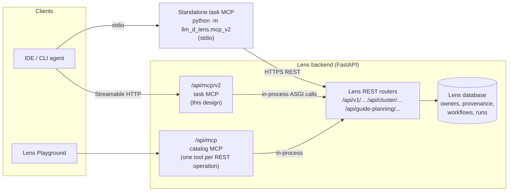

# MCP Agent Task Tools Design

> **Status: proposal for review.** Implementation follows after review. This document describes the target tool surface for the agent-facing MCP server on the `feat/mcp-v2` branch (`apps/backend/src/llm_d_lens/mcp_v2/`). It replaces the experiment engine, local ownership ledger and parallel deployment model of the first iteration with tools that map directly onto Lens concepts. Nothing in this document changes Lens REST behavior; optional Lens-side changes are listed separately in §9.3 and are not required for the design to work.

## 1. Summary, goals and non-goals

### 1.1 Summary

Lens already exposes an in-process MCP endpoint (`/api/mcp`, see [MCP tools and Playground design](mcp-playground-design.md)) that publishes roughly one tool per REST operation. That catalog is complete but low level: an agent must chain guide planning, rendering, artifact storage and evaluation creation by itself, shuttle large manifests between calls, and poll opaque dictionaries.

This design defines a second, smaller tool surface for coding and operations agents: **task tools**. Each task tool corresponds to a unit of work a person does in the Lens UI (deploy a guide, run an evaluation, benchmark a running deployment, publish a model service) and is implemented as a thin composition of existing Lens REST operations. Task tools keep Lens concept and field names, add summaries, validation and actionable error hints, and never hold long-running state themselves: every long-running task is a Lens resource (deployment run, evaluation workflow, benchmark run, simulation task) that Lens advances server-side whether or not an agent is watching.

The target surface has **52 tools** in six profiles; the default `core` profile has 26. A first iteration with 48 tools already exists on this branch; §13.1 describes what this design keeps and what it changes.

### 1.2 Goals

1. An agent can deploy a guide, run a multi-configuration evaluation, benchmark an existing deployment, inspect results and clean up, using only task tools and only Lens concepts.
2. Fire-and-forget semantics, like `kubectl apply`: start tools return a Lens id and a suggested poll interval immediately; progress never depends on the agent polling.
3. Any blocking wait is explicit, bounded and opt-in.
4. One field vocabulary: Lens guide-planning fields for topology and Lens evaluation fields for benchmarks. No third naming scheme.
5. An agent never mutates a resource that its caller does not own, even when Lens RBAC would allow it.
6. The task server is stateless: it can be restarted, moved or run by several clients at once without losing or corrupting anything.

### 1.3 Non-goals

- Replacing the in-process catalog MCP at `/api/mcp`. Both remain; see §3.3.
- A scheduler, queue or experiment engine outside Lens. If Lens cannot express something (for example, interleaving cases across plans), the task layer does not emulate it.
- New Lens REST endpoints as a prerequisite. The design works on current Lens; §9.3 lists optional improvements.
- Arbitrary Kubernetes access. Task tools only call Lens REST.
- Cross-user GPU quota or fair-share scheduling.

## 2. Design principles

1. **Lens-native concepts.** Tools are named after and return Lens entities: Guide, hardware profile, configuration artifact, deployment run, case and execution, evaluation workflow and case, BenchmarkPlan, BenchmarkScenario, baseline type, benchmark run, Model Service group and member, model access token, storage volume, model cache entry, simulation task. Identifiers are Lens ids. The task layer invents no entity.
2. **Lens field names.** Topology and runtime inputs use the camelCase fields of the guide-planning request (`replicas`, `tensorParallelSize`, `prefillReplicas`, `prefillTensorParallelSize`, `decodeReplicas`, `decodeTensorParallelSize`, `maxModelLen`, `runtimeImage`, `guideVariant`, ...). Benchmark inputs use the snake_case fields of the evaluation models (`scenarios`, `baseline_types`, `preserve_deployment`, `concurrency_stages`, `matrix`, ...). The mixed casing is a Lens fact; the task layer passes it through rather than adding a mapping.
3. **Stateless task layer.** Where Lens keeps state, the task layer keeps none: no local experiment records, plan store or ownership ledger. Everything a tool returns can be recomputed from Lens.
4. **Fire-and-forget; Lens owns long-running state.** Start tools return `{id, status, poll_after_seconds, next}` and exit. Evaluation workflows already run as server-side tasks that survive a Lens restart (`_resume_evaluations_on_startup` in `apps/backend/src/llm_d_lens/evaluation/router.py`).
5. **Explicit, bounded waits.** Only `get_*` tools accept `wait_seconds` (0 to 50, default 0) and `wait_for` (`change` or `terminal`). When set, the tool really waits; otherwise it returns immediately.
6. **Agent-friendly output.** Every response is a compact summary first (status, counts, the one active item, timestamps, warnings), with detail behind an `include` enum. Errors carry a stable `code`, the offending `field` and a `hint` naming the next tool to call.
7. **Never mutate what the caller does not own.** Before every write the task layer reads the owner that Lens recorded and compares it with the authenticated user. Unknown owner means refuse. This is a client-side guard layered on top of Lens RBAC, not a replacement for it (§9, §11).

## 3. Architecture

### 3.1 Placement



The task server runs in one of two modes, both already present on the branch:

| Mode | Entry point | Transport to Lens | Identity |
| --- | --- | --- | --- |
| In-process | `POST /api/mcp/v2` (`mcp_v2/router.py`), stateless Streamable HTTP, mounted next to `/api/mcp` | In-process ASGI calls (`AsgiLensApi`) that forward the caller's cookie or `Authorization` header and mark the request source as `assistant` | The authenticated caller of `/api/mcp/v2` |
| Standalone | `python -m llm_d_lens.mcp_v2` (`mcp_v2/__main__.py`), stdio | HTTPS to `LENS_BASE_URL` (`HttpLensApi`) | The Lens account configured for the process (`LENS_USERNAME` / `LENS_PASSWORD`, logged in through `POST /api/v1/auth/login`) |

In both modes the task layer only calls Lens REST routes; it does not import Lens services, DAOs or Kubernetes clients. This keeps it an ordinary API client whose behavior is bounded by Lens validation and RBAC.

### 3.2 Identity and authorization

- The current user is read from `GET /api/v1/auth/session` and cached per call.
- Lens resolves permissions per request (`apps/backend/src/llm_d_lens/auth/policy.py`). The task layer never elevates; a 403 is returned to the agent as `FORBIDDEN` with the missing permission when Lens names it.
- Lens records the creator as `owner_user_id` on evaluation workflows, benchmark runs, deployment batches and Model Service groups. The task layer uses it for the ownership guard (§9).
- Profiles limit what an agent sees: `LENS_MCP_V2_PROFILES=core,serving,...` (default `core`). The `cluster-admin` profile is intended only for administrator identities.
- On a 401 the standalone server re-authenticates once with its configured credentials and retries; if that fails the tool returns `UNAUTHENTICATED` with a hint naming the configuration keys to check.

### 3.3 Relationship to the existing catalog MCP and to REST

| Aspect | Catalog MCP (`/api/mcp`, `llm_d_lens.mcp`) | Task MCP (`/api/mcp/v2`, `llm_d_lens.mcp_v2`) |
| --- | --- | --- |
| Granularity | One tool per REST operation (about 200), generated from route `operation_id`, `summary` and `description` | One tool per user task (52), hand-written |
| Schemas | Request models as published by the routes | Curated subsets with Lens field names, enums spelled out |
| Output | Raw REST payloads | Summaries, derived progress, warnings, hints |
| Long-running work | `wait_for_status` polls a read tool (default 60 s, 5 s interval) | `wait_seconds` inside each `get_*` tool, bounded at 50 s |
| State | None | None (after this design) |
| Intended client | Lens Playground, exploratory use | Coding and operations agents running multi-step workflows |

The two surfaces share the same REST routes, the same RBAC and the same audit source tag. A Lens route that changes is picked up by the catalog automatically; the task layer is protected by contract tests against recorded responses (§12).

## 4. Concept mapping

| Lens concept | Where it lives in Lens | Task MCP primitive |
| --- | --- | --- |
| Cluster and cluster session | `/api/cluster/clusters`, `/api/cluster/session`, `/api/cluster/overview` | `list_clusters`, `get_cluster`; the session id is resolved internally and never asked from the agent |
| Guide (catalog entry, variant, accelerator, model server) | `GET /api/guide-planning/catalog` | `list_guides`, returning the catalog plus the plan fields each guide reads |
| Guide plan request fields | `POST /api/guide-planning/plan` (`deploy/guide_planning.py`) | The shared `GuidePlanFields` input object (§5.2) |
| Hardware profile (resources, runtime image, scheduling) | `apps/backend/src/llm_d_lens/hardware/`, `GET /api/v1/hardware/capabilities` | Defaults surfaced by `list_guides` (`default_runtime_image`); never overridden by the task layer |
| Configuration artifact | `/api/v1/configurations/render`, `/save`, `/artifacts` | Created implicitly by `start_experiment`; listable and deletable through `list_resources` / `delete_resources` |
| Deployment run, case, execution | `/api/v1/deployments/runs`, `/executions` | `create_deployment`, `get_deployment`, `update_deployment`, `stop_deployment`, `restart_deployment`; `deployment_id` is a run id (an execution id is also accepted) |
| Data plane of an execution (`shared_gateway`, `standalone_router`, `direct`) | `DeploymentExecution.data_plane` (`deploy/contracts.py`), `deploy/data_plane.py` | Reported by `get_deployment`; decides how `start_benchmark` reaches the deployment |
| Model cache entry | `/api/v1/model-cache/entries` | `cache_model`, `get_model` (cache status) |
| Storage volume | `/api/v1/storage/volumes` | `create_storage_volume`, `get_storage_volume`, `scan_storage_volume` |
| Evaluation workflow and case | `POST /api/v1/evaluate/evaluations`, `/api/v1/evaluate/workflow-runs` | **Experiment**: `plan_experiment`, `start_experiment`, `get_experiment`, `cancel_experiment`, `retry_experiment`, `compare_results`; `experiment_id` is the workflow id |
| BenchmarkPlan, BenchmarkScenario, BenchmarkSpec, SLA targets | `evaluation/models.py` | Accepted verbatim inside `ExperimentDesign` (§7.2) and `start_benchmark` |
| Baseline types and comparison core parameters | `BenchmarkPlan.baseline_types`, `baseline_parameters` | `ExperimentDesign.baseline_types`, `baseline_parameters` |
| Benchmark run (against an existing endpoint) | `/api/v1/evaluate/runs` | `start_benchmark`, `get_benchmark`, `cancel_benchmark` |
| Model Service group, member, access grant | `/api/v1/model-service/admin/...` | `publish_model_service`, `get_model_service`, `update_model_service`, `enable_model_service`, `disable_model_service`, `grant_model_service_access`, `revoke_model_service_access` |
| Model access token (`lens-mk-...`) | `/api/v1/model-service/tokens` | Used internally by `start_benchmark`, `test_model_service` and `start_simulation`; never accepted as a tool argument (§11) |
| Simulation task, trace dataset | `/api/simulation/...` | `list_trace_datasets`, `prepare_trace_dataset`, `start_simulation`, `get_simulation`, `cancel_simulation` |
| Owner, RBAC, provenance | `owner_user_id` columns, `auth/`, `provenance` dicts on runs | Ownership guard on every write (§9); `provenance.created_via = "lens-mcp"` on resources the task layer creates |
| Orphan namespaces | `/api/v1/deployments/orphans` | `delete_orphan_resources` (`cluster-admin` profile) |

## 5. Tool reference

### 5.1 Conventions shared by all tools

- **Risk tiers.** `R` read only; `W` non-destructive write; `S` consumes accelerators or cluster capacity; `D` destructive (stops traffic, deletes data or releases resources); `A` cluster administration. MCP annotations follow the tier: `R` sets `readOnlyHint`; `D` sets `destructiveHint`; `openWorldHint` is set only when the tool reaches a system outside Lens and the cluster (Hugging Face, external AI providers).
- **Ids.** All ids are Lens ids. `deployment_id` is a deployment run id; an execution id is also accepted and resolved to its run. `experiment_id` is an evaluation workflow id. `benchmark_run_id` is a benchmark run id. During migration (§13) the legacy `exp-*` ids of the first iteration are accepted read and cancel only.
- **Long-running results.** Start tools and `get_*` tools on long-running resources return the Lens `status` verbatim, plus `poll_after_seconds`, `last_progress_at` with its source field, and `next` (the suggested follow-up call).
- **Waiting.** Only `get_*` tools take `wait_seconds` (integer 0 to 50, default 0) and `wait_for` (`change` or `terminal`, default `change`). See §10.3.
- **Enums in schemas.** Every closed set (`include`, `kinds`, `wait_for`, baseline types, ...) is published as a JSON Schema `enum`, so an agent never learns valid values from an error.
- **Writes check ownership first** (§9.2). Failures are `NOT_OWNER` or `OWNER_UNKNOWN` and are not retryable.
- **Endpoint notation.** Each endpoint is listed with its route `operation_id`. Routes marked "no operation_id" are not generated into the catalog MCP from their decorator; where the catalog MCP exposes them through a special handler, that handler name is given instead.

### 5.2 Shared input object: `GuidePlanFields`

`plan_deployment`, `create_deployment`, `plan_experiment` and `start_experiment` share one input object whose properties are the guide-planning request fields read by `apps/backend/src/llm_d_lens/deploy/guide_planning.py`:

| Field | Type | Notes |
| --- | --- | --- |
| `guide` | string | Catalog guide id, for example `pd-disaggregation`, `optimized-baseline`. |
| `accelerator` | string | Catalog accelerator id; may be omitted when the catalog offers exactly one. |
| `modelServer` | string | Default `vllm`. |
| `guideVariant` | string | One of the catalog `variants` for the chosen model server. |
| `model` | string | Hugging Face model id. |
| `replicas`, `tensorParallelSize` | integer | Serving topology for non-PD guides. For `pd-disaggregation` they are aliases of `decodeReplicas` and `decodeTensorParallelSize`, matching the UI. |
| `prefillReplicas`, `prefillTensorParallelSize`, `decodeReplicas`, `decodeTensorParallelSize` | integer | PD roles. Only `guide == "pd-disaggregation"` produces prefill and decode roles in Lens. |
| `maxModelLen`, `maxNumSeqs`, `gpuMemoryUtilization`, `blockSize`, `maxNumBatchedTokens` | number | vLLM runtime parameters, translated by `deploy/guide_runtime.py`. |
| `customParameters` | object | Passed through unchanged. |
| `runtimeImage` | string | Optional. When omitted Lens resolves `deployment.runtime_image` from the hardware profile. |
| `modelSource`, `modelPath`, `modelPvcClaimName` | string | Model location, passed through. |
| `guideSettings` | object | `rdmaNicCount`, `cacheCpuGiB`, `routerValues`. |

The task layer does exactly two things to this object: it fills the defaults the UI fills (`modelServer`, the only `accelerator`, `clusterSessionId`, `environment: {mode: "current", kubernetesMode: "required"}`), and it applies the PD aliasing. It returns `FIELD_CONFLICT` when an alias and its target are both set with different values, and `FIELD_NOT_APPLICABLE` when prefill or decode fields are sent for a non-PD guide. All other fields go to Lens unchanged and Lens validation errors are returned with their field paths.

### 5.3 Discovery and catalog (`core`, 6 tools)

| Tool | Purpose and Lens concept | REST endpoints wrapped | Key inputs | Key outputs | Risk | Added beyond the raw API |
| --- | --- | --- | --- | --- | --- | --- |
| `list_clusters` | Clusters the caller can use and their session state | `GET /api/cluster/clusters` (`list_clusters`), `GET /api/cluster/session` (`get_cluster_session`), `GET /api/cluster/overview` (`get_cluster_overview`) | none | `[{cluster_id, name, session_id, session_status, accelerators[{type, total, free}]}]` | R | Joins cluster, session and capacity into one row per cluster |
| `get_cluster` | Readiness of one cluster for deploying guides | `GET /api/cluster/overview`, `GET /api/cluster/clusters/{cluster_id}/crds` (`get_cluster_crds`), `.../lws` (`get_cluster_lws`), `.../kubernetes-version` (`get_cluster_kubernetes_version`), `GET /api/v1/model-service/admin/gateway/status` (`get_model_gateway_status`), `GET /api/cluster/sessions/{session_id}/planning-discovery/{resource}` (`read_cluster_planning_discovery`) | `cluster_id`, `include` enum `capacity, components, storage, gateway, network` | Free accelerators per node, component readiness, gateway state, `network.rdma_nics_per_node` from `resourceslices` | R | Readiness verdict with hints; RDMA discovery used by planning warnings |
| `list_guides` | The Guide catalog | `GET /api/guide-planning/catalog` (no operation_id; catalog MCP handler `get_guide_catalog`), `GET /api/v1/hardware/capabilities` (`list_hardware_capabilities`) | `cluster_id` (optional when only one cluster exists), `guide`, `accelerator` | Catalog entries verbatim plus `plan_fields[]` (the `GuidePlanFields` names the guide reads) and `default_runtime_image` from the hardware profile | R | `plan_fields` derived from Lens planning rules (§15) so agents use the right names |
| `search_models` | Hugging Face search plus what is already cached | `GET /api/v1/model-cache/huggingface/search` (`search_huggingface_models`), `GET /api/v1/model-cache/entries` (`list_model_cache_entries`) | `query` (optional), `cluster_id`, `limit` | `[{model, params_b, cached_on[], license}]` | R | Without `query`, lists models cached on the cluster |
| `get_model` | Model facts, fit and cache state | `GET /api/v1/model-cache/huggingface/models/{repo_id}` (`get_huggingface_model`), `POST /api/v1/capacity/estimate` (no operation_id; catalog MCP handler `estimate_vllm_capacity`), `GET /api/v1/model-cache/entries` | `model`, `cluster_id`, `include` enum `fit, facts, cache, storage` | `fit.per_tp[{tensorParallelSize, fits, weights_gib, kv_headroom_gib}]`, cache status | R | Per tensor-parallel fit table |
| `cache_model` | Create a Model Cache entry on a storage volume | `POST /api/v1/model-cache/entries` (`create_model_cache_entry`), `POST /api/v1/model-cache/entries/{entry_id}/retry` (`retry_model_cache_entry`), `GET /api/v1/storage/volumes` (`list_storage_volumes`) | `model`, `cluster_id`, `storage_volume_id` | `model_cache_id`, `status`, `poll_after_seconds` | W | Picks the only model-storage volume; `NO_MODEL_STORAGE` hint points to `create_storage_volume` |

### 5.4 Deployments (`core`, 9 tools)

| Tool | Purpose and Lens concept | REST endpoints wrapped | Key inputs | Key outputs | Risk | Added beyond the raw API |
| --- | --- | --- | --- | --- | --- | --- |
| `plan_deployment` | Guide plan, without side effects on the cluster | `POST /api/guide-planning/plan` (no operation_id; handler `plan_guide_deployment`) | `cluster_id`, `GuidePlanFields` | `valid`, `gpus`, `roles[{role, replicas, tensorParallelSize, gpus}]`, resolved `runtimeImage`, deduplicated `warnings[]`, `request_digest` | R | Summary instead of rendered manifests; PD aliasing; RDMA hint; digest for `expected_digest` |
| `create_deployment` | Deployment run, as the UI creates it from a plan | `POST /api/guide-planning/plan`, `POST /api/v1/deployments/runs` (`create_deployment_run`) | `GuidePlanFields`, `deployment_name`, `description`, `expected_digest`, `client_request_id` | `deployment_id` (run id), `status`, `poll_after_seconds` (30), `next` | S | Writes `provenance: {created_via: "lens-mcp", mcp_user_id}`; `PLAN_STALE` when the plan changed; Lens 409 capacity errors mapped to `INSUFFICIENT_CAPACITY` |
| `get_deployment` | Run, case and execution state | `GET /api/v1/deployments/runs/{run_id}` (`get_deployment_run`), `GET /api/v1/deployments/executions/{execution_id}` (`get_deployment_execution`), `GET .../executions/{execution_id}/pods` (`get_deployment_execution_pods`) | `deployment_id`, `include` enum `pods, roles, endpoint, restart_check`, `wait_seconds`, `wait_for` | `status`, `phase`, `owner`, `data_plane`, `roles[]`, `last_progress_at`, `poll_after_seconds` | R | One summary across three resources; stale detection; bounded wait |
| `update_deployment` | Execution metadata and replica scaling | `PATCH /api/v1/deployments/executions/{execution_id}` (`patch_deployment_execution`; only `display_name` up to 120 and `description` up to 1000), `POST .../executions/{execution_id}/scale` (`scale_deployment_execution`; `prefill_replicas`, `decode_replicas` 1 to 100) | `deployment_id`, `display_name`, `description`, `prefill_replicas`, `decode_replicas` | Updated summary | W | Ownership guard; explains that scale changes live replicas only, not the saved configuration |
| `stop_deployment` | Release accelerators | `POST /api/v1/deployments/runs/{run_id}/cancel` (`cancel_deployment_run`) while the run is still creating; `POST .../runs/{run_id}/cases/{case_id}/stop` (`stop_deployment_case`) once ready | `deployment_id`, `reason` | `status` (`cancelling` or `stopped`) | D | Chooses cancel or stop from state; `EVALUATION_OWNED` hint redirects to `cancel_experiment` for deployments created by a workflow |
| `restart_deployment` | Restart a stopped or failed case as a new attempt | `POST .../runs/{run_id}/cases/{case_id}/restart` (`restart_deployment_case`) | `deployment_id` | New case id, `poll_after_seconds` | S | Pre-checks that the case is stopped or failed and is the latest attempt; `CONFLICT_STATE` hint otherwise |
| `diagnose_deployment` | Rule-based diagnosis of a deployment | `GET` execution, pods, `GET .../executions/{execution_id}/pods/{pod_name}/logs` (`get_deployment_pod_logs`, bounded `tail`), `GET .../runs/{run_id}/cases/{case_id}/logs` (`get_deployment_case_logs`) | `deployment_id` | `findings[{severity, code, evidence, hint}]` | R | Rules for pending pods, image pulls, OOM, readiness; PD rules (RDMA available but `guideVariant` is `base`, NIXL transfer times parsed from bounded decode logs) |
| `test_deployment` | One inference request as a smoke test | `POST /api/v1/deployments/executions/{execution_id}/endpoint` (`connect_deployment_execution_endpoint`), then the returned endpoint | `deployment_id`, `prompt`, `max_tokens` (at most 64) | `ok`, `latency_ms`, `excerpt` | W | Fails fast with `ENDPOINT_UNREACHABLE` when the forwarded endpoint is not reachable from the task server; never opens its own port forward |
| `get_logs` | Pod logs by role, pod and container | `GET .../executions/{execution_id}/pods` , `GET .../executions/{execution_id}/pods/{pod_name}/logs` (`get_deployment_pod_logs`; `container`, `tail`, `previous`) | `deployment_id`, `role`, `pod`, `container`, `tail` (default 200, max 2000), `previous`, `grep` | Lines grouped by pod, marked as untrusted text | R | Role-to-pod resolution; client-side `grep` capped at 200 returned lines |

### 5.5 Experiments on Evaluation workflows (`core`, 6 tools)

Details and lifecycle are in §7.

| Tool | Purpose and Lens concept | REST endpoints wrapped | Key inputs | Key outputs | Risk | Added beyond the raw API |
| --- | --- | --- | --- | --- | --- | --- |
| `plan_experiment` | Dry run of an Evaluation: what Lens would deploy and run | `POST /api/guide-planning/plan`, `POST /api/v1/configurations/render` (`render_configuration`), `POST /api/v1/evaluate/timing-estimate` (`estimate_benchmark_timing`) | `ExperimentDesign` (§7.2) | Per plan topology, GPUs and image; `case_order[]`; `cases_total`; `peak_gpus`; `gpu_hours_estimate`; `eta_seconds{benchmark, deploy, basis}`; `limits`; `fits_now`; deduplicated `warnings[]`; `request_digest` | R | Expands repetitions and order; checks Lens limits before anything is saved; budget and ETA |
| `start_experiment` | Create an Evaluation workflow | The three above, plus `POST /api/v1/configurations/save` (`save_configuration`) and `POST /api/v1/evaluate/evaluations` (`create_evaluation`); `DELETE /api/v1/configurations/artifacts/{artifact_id}` (`delete_configuration_artifact`) on failure | `ExperimentDesign`, `expected_digest`, `client_request_id` | `experiment_id` (workflow id), `status`, `cases_total`, `case_order`, `artifact_ids`, `seed`, `eta_seconds`, `poll_after_seconds` (60) | S | One call replaces the plan, render, save and create chain; explicit `include_baseline`; best-effort artifact cleanup on failure |
| `get_experiment` | Workflow status, active case, progress and results | `GET /api/v1/evaluate/workflow-runs/{workflow_id}` (`get_evaluation_workflow`); for the active case `GET /api/v1/evaluate/runs/{run_id}` (`get_evaluate_run`) or `GET /api/v1/deployments/runs/{run_id}`; `GET .../workflow-runs/{workflow_id}/details` (`get_evaluation_workflow_details`) only when results are requested | `experiment_id`, `include` enum `cases, results, comparison, points`, `wait_seconds`, `wait_for` | `status`, `progress{...}`, `active_case{...}`, `last_progress_at`, `stale{is_stale, reason, hint}`, `eta_remaining_seconds`, `poll_after_seconds` | R | Derived progress and stale detection (§7.5); results summarized per plan and scenario |
| `cancel_experiment` | Cancel a workflow or some of its cases | `POST /api/v1/evaluate/workflow-runs/{workflow_id}/cancel` (`cancel_evaluation_workflow`), `POST .../workflow-runs/{workflow_id}/cases/{case_id}/cancel` (`cancel_evaluation_case`) | `experiment_id`, `case_ids`, `reason` | `status`, `cancelled_case_ids`, `cleanup{state, errors[]}`, `poll_after_seconds` (15) | D | Ownership guard (Lens checks the route permission only); `CLEANUP_PENDING` is retryable |
| `retry_experiment` | Requeue failed or cancelled cases of a workflow | `POST /api/v1/evaluate/workflow-runs/{workflow_id}/retry` (`retry_evaluation_workflow`; no body) | `experiment_id` | `status`, `requeued_case_ids`, `poll_after_seconds` | S | Ownership guard; `CONFLICT_STATE` before calling Lens when the workflow is not failed or cancelled |
| `compare_results` | Compare plans across workflows and benchmark runs | `GET .../workflow-runs/{workflow_id}/details`, `GET /api/v1/evaluate/runs/{run_id}` | `experiment_ids` (up to 10), `benchmark_run_ids` (up to 50), `baseline`, `metrics` enum, `group_repetitions` | Rows `{source, plan, scenario, concurrency_or_rate, n, median, min, max, delta_vs_baseline_pct, sla_pass}` | R | Cross-workflow comparison and aggregation of repetitions, which the per-workflow Lens report does not do |

### 5.6 Benchmarking an existing deployment (`core`, 3 tools)

Details are in §8.

| Tool | Purpose and Lens concept | REST endpoints wrapped | Key inputs | Key outputs | Risk | Added beyond the raw API |
| --- | --- | --- | --- | --- | --- | --- |
| `start_benchmark` | Benchmark run against a ready deployment or Model Service, without taking over its lifecycle | `POST /api/v1/evaluate/runs` (`create_evaluate_run`); `POST /api/v1/evaluate/timing-estimate`; token handling in §8.3 | Exactly one of `deployment_id` or `model_service_id`; Lens `BenchmarkSpec` fields; `sla_targets`; `use_baseline_endpoint` | `benchmark_run_id`, `status`, `target{kind, id, data_plane}`, `timing`, `poll_after_seconds` | S | Routing by data plane and owner (§8.2); `PUBLISH_REQUIRED` and `NOT_OWNER` hints; token never in arguments |
| `get_benchmark` | Benchmark run status and metrics | `GET /api/v1/evaluate/runs/{run_id}` (`get_evaluate_run`) | `benchmark_run_id`, `include` enum `metrics, points, evidence`, `wait_seconds`, `wait_for` | `status`, `phase`, `heartbeat_at`, `last_log_at`, `stale`, metric summary, `poll_after_seconds` | R | Stale detection from the Lens heartbeat; metric summary per stage |
| `cancel_benchmark` | Cancel one's own benchmark run | `POST /api/v1/evaluate/runs/{run_id}/cancel` (`cancel_evaluate_run`) | `benchmark_run_id` | `status` | D | Ownership guard; target deployment is untouched |

### 5.7 Resources (`core`, 2 tools)

| Tool | Purpose and Lens concept | REST endpoints wrapped | Key inputs | Key outputs | Risk | Added beyond the raw API |
| --- | --- | --- | --- | --- | --- | --- |
| `list_resources` | What the caller has in Lens, across kinds | `GET /api/v1/deployments/runs` (`list_deployment_runs`), `GET /api/v1/evaluate/workflow-runs` (`list_evaluation_workflows`), `GET /api/v1/evaluate/runs` (`list_evaluate_runs`), `GET /api/v1/model-service/admin/groups` (`list_model_service_groups`), `GET /api/v1/storage/volumes`, `GET /api/v1/model-cache/entries`, `GET /api/v1/configurations/artifacts` (`list_configuration_artifacts`), `GET /api/simulation/tasks` (`list_simulation_tasks`) | `kinds` enum `deployment, experiment, benchmark_run, model_service, storage_volume, model_cache_entry, configuration_artifact, simulation`; `owner` (`me` default, `all`, or a user id); `cluster_id`; `status`; `limit` up to 100; `cursor` | `[{kind, id, name, status, owner, owner_source, created_at, gpus}]` | R | One cross-kind view; `owner_source` is `lens`, `provenance` or `unknown` (§9) |
| `delete_resources` | Delete explicitly listed resources | `DELETE /api/v1/deployments/runs/{run_id}` (`delete_deployment_run`), `DELETE /api/v1/evaluate/workflow-runs/{workflow_id}` (`delete_evaluation_workflow`), `DELETE /api/v1/evaluate/runs/{run_id}` (`delete_evaluate_run`), `DELETE /api/v1/model-service/admin/groups/{group_id}` (`delete_model_service_group`), `DELETE /api/v1/storage/volumes/{volume_id}` (`delete_storage_volume`), `DELETE /api/v1/model-cache/entries/{entry_id}` (`delete_model_cache_entry`), `DELETE /api/v1/configurations/artifacts/{artifact_id}`, `DELETE /api/simulation/tasks/{task_id}` (`delete_simulation_task`) | `items[{kind, id}]` (1 to 20), `reason` | Per item `{kind, id, outcome, also_deletes[], error}` | D | Per-item ownership guard; refuses active resources with a hint to stop or cancel first; lists cascaded deletions before deleting |

Deployments are deleted through the run, never through `DELETE /api/v1/deployments/executions/{execution_id}` (`delete_deployment_execution`), because with `delete_namespace=false` that call removes only the record and leaves workloads running.

### 5.8 Serving (`serving` profile, 8 tools)

| Tool | Purpose and Lens concept | REST endpoints wrapped | Risk | Added beyond the raw API |
| --- | --- | --- | --- | --- |
| `publish_model_service` | Publish a ready deployment as a Model Service group; access granted to the caller only by default | `GET /api/v1/model-service/admin/deployments` (`list_publishable_deployments`), `POST /api/v1/model-service/admin/groups/publish` (`publish_model_service`) | W | Accepts a Lens deployment id; `NOT_PUBLISHABLE` returns the reasons Lens gives |
| `get_model_service` | Group, member health, traffic and access grants | `GET .../admin/groups/{group_id}` (`get_model_service_group`), `GET .../admin/groups/{group_id}/access` (`list_model_service_access`), `GET .../admin/members` (`list_model_service_members`) | R | One summary of group, members and grants |
| `test_model_service` | One inference request through the Model Gateway | `GET /api/v1/model-service/connection` (`get_model_service_connection`), then the gateway | W | Uses the configured model token (§11.1); `NO_TOKEN` hint |
| `update_model_service` | Rename, describe, set traffic weights | `PATCH .../admin/groups/{group_id}` (`update_model_service_group`), `PUT .../admin/groups/{group_id}/traffic` (`update_model_service_traffic`) | W | Ownership guard; validates weights before calling Lens |
| `enable_model_service` | Enable a group | `POST .../admin/groups/{group_id}/status` (`set_model_service_status`) | W | Idempotent |
| `disable_model_service` | Disable a group (stops traffic) | `POST .../admin/groups/{group_id}/status` (`set_model_service_status`) | D | Ownership guard |
| `grant_model_service_access` | Grant a user or group access | `GET .../admin/groups/{group_id}/access/options`, `POST .../admin/groups/{group_id}/access` (`grant_model_service_access`) | W | Resolves subject names to Lens subjects |
| `revoke_model_service_access` | Revoke grants, or revoke one's own tokens by id | `DELETE .../admin/groups/{group_id}/access/{binding_id}` (`revoke_model_service_access`), `DELETE /api/v1/model-service/tokens/{token_id}` (`revoke_model_service_token`) | D | Resolves subjects to binding ids; tolerant of already-revoked items |

### 5.9 Storage (`storage` profile, 3 tools)

| Tool | Purpose and Lens concept | REST endpoints wrapped | Risk | Added beyond the raw API |
| --- | --- | --- | --- | --- |
| `create_storage_volume` | Register a storage volume (`localDisk`, `nfs` or `dynamicPvc`) for model storage | `GET /api/v1/storage/nodes` (`list_storage_nodes`), `GET /api/v1/storage/storage-classes` (`list_storage_classes`), `POST /api/v1/storage/volumes` (`create_storage_volume`) | W | Validates node names and storage class before calling Lens |
| `get_storage_volume` | Volume state, capacity, models present | `GET /api/v1/storage/volumes/{volume_id}` (`get_storage_volume`), `GET /api/v1/storage/volume-resource-status` (`get_storage_volume_resource_status`) | R | Joined summary |
| `scan_storage_volume` | Scan for models; acknowledge nodes | `POST .../volumes/{volume_id}/scan-models` (`scan_storage_volume_models`), `POST .../volumes/{volume_id}/acknowledge-nodes` (`acknowledge_storage_volume_nodes`) | W | Asks for explicit node confirmation |

The first iteration also "claimed" volumes in its local ledger and reconciled them against Lens. That logic is removed: Lens does not record owners for volumes today (§9.1), so any claim would be a guess.

### 5.10 Simulation (`simulation` profile, 5 tools)

| Tool | Purpose and Lens concept | REST endpoints wrapped | Risk | Added beyond the raw API |
| --- | --- | --- | --- | --- |
| `list_trace_datasets` | Trace datasets, scenarios and backends | `GET /api/simulation/trace-datasets` (`list_trace_datasets`), `GET /api/simulation/scenarios` (`list_simulation_scenarios`), `GET /api/simulation/backends` (`list_simulation_backends`) | R | One catalog view |
| `prepare_trace_dataset` | Download a trace dataset | `POST /api/simulation/trace-datasets/download` (`download_trace_dataset`), `GET /api/simulation/trace-datasets/{dataset_name}/timeline` (`get_trace_dataset_timeline`) | W | Idempotent when already present |
| `start_simulation` | Simulation task against a deployment or Model Service | `POST /api/simulation/tasks` (`create_simulation_task`; `endpoint_deployment_execution_id`, or `model_service_group_id` with a `lens-mk-` key) | S | Same routing and token rules as `start_benchmark` (§8) |
| `get_simulation` | Task status and response-code issues | `GET /api/simulation/tasks/{task_id}` (`get_simulation_task`), `GET .../tasks/{task_id}/response-code-issues` (`get_simulation_response_code_issues`) | R | Summary, bounded wait |
| `cancel_simulation` | Stop a task | `POST /api/simulation/tasks/{task_id}/stop` (`stop_simulation_task`) | D | `OWNER_UNKNOWN` until Lens records simulation owners (§9.3) |

### 5.11 Cluster administration (`cluster-admin` profile, 8 tools)

Not exposed to agents by default; intended for administrator identities only.

| Tool | Purpose | REST endpoints wrapped | Risk |
| --- | --- | --- | --- |
| `plan_cluster_component` | Preflight for a cluster component install | `POST /api/v1/monitoring/cluster-stack/installations/preflight` (`preflight_cluster_stack_install`), `POST /api/v1/monitoring/accelerators/{accelerator}/installations/preflight` (`preflight_accelerator_install`), `POST /api/v1/model-service/admin/gateway/preflight` (`preflight_model_gateway`), status reads (`get_cluster_stack_status`, `get_accelerator_monitoring_status`, `get_model_gateway_status`, `get_cluster_crds`, `get_cluster_lws`) | R |
| `install_cluster_component` | Install CRDs, LWS, monitoring stack, accelerator monitoring or the Model Gateway | `POST /api/cluster/clusters/{cluster_id}/crds` (`create_cluster_crds`), `POST .../lws` (`install_cluster_lws`), `POST /api/v1/monitoring/cluster-stack/installations` (`install_cluster_stack`), `POST /api/v1/monitoring/accelerators/{accelerator}/installations` (`install_accelerator_monitoring`), `POST /api/v1/model-service/admin/gateway/install` (`install_model_gateway`), operation reads (`get_cluster_stack_operation`, `get_accelerator_monitoring_operation`) | A |
| `prepull_images` | Pre-pull runtime images on nodes | `POST /api/cluster/clusters/{cluster_id}/images/prepull` (`create_cluster_image_prepull`), `GET` same path (`get_cluster_image_prepull`) | A |
| `cordon_nodes` | Cordon nodes | `POST /api/cluster/clusters/{cluster_id}/nodes/cordon` (`cordon_cluster_nodes`) | A |
| `uncordon_nodes` | Uncordon nodes | `POST /api/cluster/clusters/{cluster_id}/nodes/uncordon` (`uncordon_cluster_nodes`) | A |
| `configure_model_gateway` | Scale the gateway or set its inference-pool config | `POST /api/v1/model-service/admin/gateway/scale` (`scale_model_gateway`), `GET/POST .../gateway/ipp-config` (`get_model_gateway_ipp_config`, `set_model_gateway_ipp_config`) | A |
| `reconcile_model_gateway` | Reconcile gateway routes with published groups | `POST /api/v1/model-service/admin/gateway/reconcile` (`reconcile_model_gateway`) | A |
| `delete_orphan_resources` | List and clean orphan deployment namespaces | `GET /api/v1/deployments/orphans` (`list_orphan_deployment_namespaces`), `POST /api/v1/deployments/orphans/clean` (`clean_orphan_deployment_namespaces`) | A |

### 5.12 Lens settings (`lens-settings` profile, 2 tools)

| Tool | Purpose | REST endpoints wrapped | Risk |
| --- | --- | --- | --- |
| `list_ai_providers` | AI providers configured in Lens | `GET /api/v1/ai-providers` (`list_ai_providers`) | R |
| `test_ai_provider` | Connection test to a configured provider (reaches an external system) | `POST /api/v1/ai-providers/{provider_id}/test` (`test_ai_provider_connection`) | W |

### 5.13 Counts

| Profile | Tools | Default |
| --- | --- | --- |
| `core` | 26 | yes |
| `serving` | 8 | no |
| `storage` | 3 | no |
| `simulation` | 5 | no |
| `cluster-admin` | 8 | no |
| `lens-settings` | 2 | no |
| Total | 52 | |

In `core`, four tools are destructive (`stop_deployment`, `cancel_experiment`, `cancel_benchmark`, `delete_resources`). Hosts that ask for confirmation before destructive tools should list exactly these.

## 6. Typical agent workflows

The sequences below show how the tools compose. Arrows show which response field drives the next call. "Poll" means the agent calls a `get_*` tool again after `poll_after_seconds`, whenever it chooses to; "wait" means the agent opts into a bounded `wait_seconds` inside one call. In every workflow, progress is made by Lens, not by the calls.

### 6.0 Common requests at a glance

| What the person asks the agent | Tools the agent calls, in order | Workflow |
| --- | --- | --- |
| "Deploy Qwen3-8B on the XPU cluster" | `list_clusters` → `search_models` → `get_model` → (`cache_model`) → `list_guides` → `plan_deployment` → `create_deployment` → `get_deployment` → `test_deployment` | 6.1 |
| "Why is my deployment not ready?" | `get_deployment` → `diagnose_deployment` → `get_logs` → (`restart_deployment` or `stop_deployment`) | 6.2 |
| "Compare prefill/decode ratios 1:3, 2:2 and 3:1 against the baseline" | `list_guides` → `plan_experiment` → `start_experiment` → (agent may exit) → `get_experiment` → `compare_results` | 6.3 |
| "How fast is this running deployment?" | `start_benchmark` → `get_benchmark` | 6.4 |
| "What was I running? Is it finished?" | `list_resources` → `get_experiment` or `get_deployment` | 6.5 |
| "Clean up everything I created" | `list_resources` → `delete_resources` | 6.6 |
| "Download this model to the cluster first" | `search_models` → `cache_model` → `get_model` | 6.7 |
| "The experiment failed halfway" | `get_experiment` → `diagnose_deployment` → `retry_experiment` or `cancel_experiment` | 6.8 |

### 6.1 Deploy a model end to end

Goal: serve `Qwen/Qwen3-8B` with a Lens guide and confirm it answers.

1. `list_clusters()` → pick `cluster_id` with enough `accelerators[].free`. If none has capacity, stop and report.
2. `search_models(query="Qwen3-8B", cluster_id)` → `cached_on[]` tells whether weights are already on the cluster.
3. `get_model(model, cluster_id, include=["fit", "cache"])` → `fit.per_tp[]` gives the smallest `tensorParallelSize` that fits; `cache.status` decides step 4.
4. If not cached: `cache_model(model, cluster_id)` → `model_cache_id`; then `get_model(model, cluster_id, include=["cache"], wait_seconds=50, wait_for="terminal")` repeated until `cache.status` is ready (workflow 6.7 covers failures). Deploying without a cache also works; the download then counts against deploy time.
5. `list_guides(cluster_id)` → choose `guide`, `guideVariant`; `plan_fields[]` lists the field names to use; `default_runtime_image` shows the image Lens will pick.
6. `plan_deployment(cluster_id, guide="optimized-baseline", model, replicas=1, tensorParallelSize=1)` → check `valid`, `gpus`, `warnings[]`; keep `request_digest`. On `FIELD_NOT_APPLICABLE` or `PLAN_INVALID`, fix the fields named in `error.field` and plan again.
7. `create_deployment(..., expected_digest=request_digest, client_request_id="qwen3-8b-1")` → `deployment_id`, `poll_after_seconds: 30`. On `PLAN_STALE`, return to step 6. On `INSUFFICIENT_CAPACITY`, report the free accelerators from the hint.
8. Poll `get_deployment(deployment_id)` every `poll_after_seconds`, or opt in to `wait_seconds=50, wait_for="terminal"`. Exit when `status` is ready or failed, or when `stale.is_stale` is true.
9. Ready: `test_deployment(deployment_id)` → `ok`, `latency_ms`. On `ENDPOINT_UNREACHABLE` (the forwarded endpoint is not reachable from the task server), use `diagnose_deployment` and readiness from `get_deployment` instead, or measure it with workflow 6.4. Failed or stale: continue with workflow 6.2.

### 6.2 Diagnose a failing or slow-to-start deployment

Goal: explain why a deployment is not ready and act on it.

1. `get_deployment(deployment_id, include=["pods", "roles"])` → `status`, `phase`, `last_progress_at`, `stale{reason, hint}`, pod states per role, `owner`.
2. `diagnose_deployment(deployment_id)` → `findings[{severity, code, evidence, hint}]`, for example image pull failure, unschedulable pods, OOM, readiness probe failures, or for PD guides `RDMA_AVAILABLE_NOT_USED` and slow NIXL transfers.
3. `get_logs(deployment_id, role="decode", tail=300, grep="ERROR|Traceback")` for the pod named in the evidence; add `previous=true` for crash loops.
4. Act according to the finding:
   - Wrong runtime parameter or topology: `stop_deployment(deployment_id)`, then plan and create again with corrected `GuidePlanFields` (workflow 6.1, steps 6 to 8).
   - Transient failure (node pressure, image pull timeout): `restart_deployment(deployment_id)` → new case id; poll `get_deployment` again.
   - Only metadata or replica count needs to change: `update_deployment(deployment_id, decode_replicas=2)`.
5. Any write that returns `NOT_OWNER` or `OWNER_UNKNOWN` ends the workflow with a report to the user; the agent does not try another route to modify the deployment. `EVALUATION_OWNED` from `stop_deployment` means the deployment belongs to a workflow; use `cancel_experiment` on that workflow instead.

### 6.3 PD ratio benchmark matrix as a fire-and-forget experiment

Goal: compare prefill/decode ratios 1:3, 2:2 and 3:1 on four accelerators against an aggregated baseline, without keeping an agent session open.

1. `list_guides(cluster_id, guide="pd-disaggregation")` → `plan_fields[]` confirms `prefillReplicas`, `decodeReplicas`, `prefillTensorParallelSize`, `decodeTensorParallelSize`.
2. `plan_experiment(design)` with:
   - `common: {guide: "pd-disaggregation", model, guideVariant: "rdma"}`
   - `variants: [{id: "p1d3", plan: {prefillReplicas: 1, decodeReplicas: 3}}, {id: "p2d2", ...}, {id: "p3d1", ...}]`
   - `scenarios: [{id: "in4k-out128", benchmark: {...}}, {id: "in256-out1k", benchmark: {...}}]`
   - `baseline_types: ["optimized-baseline"]`, `baseline_parameters: {"optimized-baseline": {"replicas": 4}}`
   - `repetitions: {count: 2, mode: "same_deployment"}`, `order: "shuffled"`
   → check `valid`, `cases_total`, `peak_gpus`, `eta_seconds`, `warnings[]` (for example `REPEATS_SHARE_DEPLOYMENT`, `RDMA_AVAILABLE_NOT_USED`); keep `request_digest` and `seed`. On `LIMIT_EXCEEDED`, follow the hint (switch repetition mode or split).
3. `start_experiment(design, expected_digest, client_request_id="pd-ratio-1")` → `experiment_id`, `status: queued`, `eta_seconds`, `poll_after_seconds: 60`.
4. The agent may now end its session. Lens deploys each plan, runs the scenarios, deploys the baseline, cleans up, and resumes after a Lens restart. Nothing in the task layer needs to be called for the experiment to progress.
5. Later, in any session: `get_experiment(experiment_id)` → `status`, `progress{succeeded, failed, queued, ...}`, `active_case`, `last_progress_at`, `eta_remaining_seconds`. If `stale.is_stale`, follow `stale.hint` (usually `diagnose_deployment` on `active_case.deployment.run_id`). If the agent happens to be waiting for the last case, it may opt in to `wait_seconds=50, wait_for="terminal"`; otherwise it checks back after `poll_after_seconds`.
6. Terminal: `get_experiment(experiment_id, include=["results"])` → per plan and scenario metrics, SLA results.
7. `compare_results(experiment_ids=[experiment_id], baseline={experiment_id, plan_id: "optimized-baseline"}, metrics=["ttft_p99", "tpot_p50", "output_tps"], group_repetitions=true)` → rows with `n`, `median`, `min`, `max`, `delta_vs_baseline_pct`.
8. Cleanup: deployments were removed by Lens after each plan (no `preserve_deployment`). Keeping the workflow keeps the results; `delete_resources(items=[{kind: "experiment", id: experiment_id}])` removes the workflow, its benchmark history and the saved artifacts when no longer needed. Failed cases: workflow 6.8.

### 6.4 Quick benchmark of an existing deployment

Goal: measure a running deployment with one workload without redeploying it.

1. `get_deployment(deployment_id)` → `status` must be ready; read `owner` and `data_plane`.
2. `start_benchmark(deployment_id, benchmark={...}, sla_targets={...})`:
   - Own deployment with `data_plane` `standalone_router` or `direct` → `benchmark_run_id`, `timing`, `poll_after_seconds`. Continue at step 4.
   - `PUBLISH_REQUIRED` (own deployment behind the shared gateway) → step 3.
   - `NOT_OWNER` or `OWNER_UNKNOWN` → ask the owner to publish the deployment and grant access; once they share a `model_service_id`, continue at step 3b.
3. Benchmark through the Model Service:
   - 3a. Own deployment only: `publish_model_service(deployment_id)` (`serving` profile) → `model_service_id`, access granted to the caller only.
   - 3b. `start_benchmark(model_service_id, benchmark={...})` → `benchmark_run_id`. The task layer uses `LENS_MODEL_TOKEN` if configured, otherwise a temporary `lens-mcp-bench` token it creates and later revokes; `NO_TOKEN` means neither is possible and names the configuration key to set.
4. Poll `get_benchmark(benchmark_run_id)` every `poll_after_seconds`, or `wait_seconds=50, wait_for="terminal"` for short workloads. `stale.is_stale` is computed from the Lens `heartbeat_at`.
5. Terminal: `get_benchmark(benchmark_run_id, include=["metrics"])`; optionally `compare_results(benchmark_run_ids=[...])` against earlier runs.
6. To stop early: `cancel_benchmark(benchmark_run_id)`; the target deployment is not affected. Do not retry `start_benchmark` blindly after a timeout: first check `list_resources(kinds=["benchmark_run"], status="active")`, because benchmark creation is not idempotent.

### 6.5 Resume after the agent session restarted

Goal: pick up work started in an earlier session with no memory of its ids.

1. `list_resources(kinds=["experiment", "benchmark_run", "deployment"], owner="me", status="active")` → `[{kind, id, name, status, created_at, gpus}]`. Names carry `[req:<client_request_id>]` when one was given, which identifies the agent's own submissions.
2. For each experiment: `get_experiment(id)` → current status and `poll_after_seconds`; continue with workflow 6.3 step 5.
3. For each benchmark run: `get_benchmark(id)`; for each deployment: `get_deployment(id)`.
4. To recover recently finished work as well, repeat step 1 without the `status` filter and sort by `created_at`.
5. Resources created in the Lens UI or by other clients appear with `owner_source: "unknown"` until L1 lands; the agent may read them but not change them.

### 6.6 Clean up everything the caller created

Goal: release accelerators and remove the caller's leftovers without touching anyone else's resources.

1. `list_resources(owner="me")` → all kinds with `owner_source`. Resources with `owner_source: "unknown"` are listed for information only.
2. Stop active work first: `cancel_experiment(id)` for non-terminal experiments, `cancel_benchmark(id)` for active benchmark runs, `stop_deployment(id)` for running standalone deployments. Re-check with `list_resources(owner="me", status="active")`; repeat `cancel_experiment` on `CLEANUP_PENDING`.
3. `delete_resources(items=[{kind, id}, ...])` with explicit ids (up to 20 per call) → per item `outcome` and `also_deletes[]`. Deleting an experiment also deletes its preserved deployments and benchmark history; this is listed before deletion.
4. Items refused with `CONFLICT_STATE` are still active (back to step 2). Items refused with `NOT_OWNER` or `OWNER_UNKNOWN` are reported to the user and left alone; this includes volumes, cache entries and simulation tasks until Lens records their owners (L2).
5. Orphaned namespaces from failed cleanups can only be removed by an administrator with `delete_orphan_resources`; the agent reports them rather than escalating.

### 6.7 Prepare the model cache for a new model

Goal: have weights on cluster storage before an experiment, so deploy time is predictable.

1. `get_model(model, cluster_id, include=["facts", "fit", "storage"])` → size, license, fit, the model-storage volumes available.
2. `NO_MODEL_STORAGE` from `cache_model` or an empty storage list: with the `storage` profile, `create_storage_volume(...)` and `get_storage_volume(volume_id)` until it is ready; otherwise report that an operator must create a model-storage volume.
3. `cache_model(model, cluster_id, storage_volume_id)` → `model_cache_id`, `poll_after_seconds`.
4. Poll `get_model(model, cluster_id, include=["cache"])`, or `wait_seconds=50` per call for small models. Large downloads take minutes to hours; the agent can end its session and check later, since the download runs in Lens.
5. On a failed cache entry, read the error in `cache.status`; for transient failures `cache_model` again (it retries the existing entry through `retry_model_cache_entry`); for gated models, report the token requirement.
6. Use the cached model in `plan_deployment` or `plan_experiment`; `plan_*` reports the model source Lens resolved.

### 6.8 Cancel or retry a failed experiment

Goal: recover from a partially failed experiment, or stop one that is going wrong.

1. `get_experiment(experiment_id, include=["cases"])` → per case `{id, kind, plan_id, scenario_id, status, error, cleanup_error}`.
2. Going wrong while running (for example, one variant keeps failing to deploy): `cancel_experiment(experiment_id, case_ids=[...])` cancels only those cases and lets the rest continue; `cancel_experiment(experiment_id)` cancels everything. Lens cleans the deployments it owns. `CLEANUP_PENDING` is retryable; call `cancel_experiment` again after `poll_after_seconds`.
3. Failed or cancelled with a transient cause (capacity taken by another user, expired cluster session): `retry_experiment(experiment_id)` → `requeued_case_ids`; Lens requeues failed and cancelled cases, keeps succeeded results and rebinds the cluster session. Continue with workflow 6.3 step 5.
4. Failed because of the design (wrong field, bad scenario): do not retry. Fix the design, then `plan_experiment` and `start_experiment` as a new experiment; compare old and new with `compare_results(experiment_ids=[old, new])`.
5. `CONFLICT_STATE` from `retry_experiment` means the workflow is not failed or cancelled; `NOT_OWNER` means it belongs to someone else and must not be changed.

## 7. Experiments on top of Evaluation workflows

### 7.1 Why Evaluation workflows

The Lens UI's "deploy configurations and evaluate" flow is already fully programmatic: for each topology it calls guide planning, renders and saves a configuration artifact, then creates one Evaluation whose `benchmark_plans` reference those artifacts by `configuration_artifact_id` (`POST /api/v1/evaluate/evaluations`). Lens then runs the workflow server-side as an `asyncio` task: it records `owner_user_id` from the caller, deploys each plan, runs the benchmark harness for each scenario, cleans up deployments it owns (unless `preserve_deployment` is set), persists every case, and resumes queued and running workflows after a restart. An "experiment" in the task layer is therefore exactly one Evaluation workflow and `experiment_id` is its workflow id. The task layer only builds the request and summarizes the result.

### 7.2 `ExperimentDesign`

| Field | Type and limits | Maps to |
| --- | --- | --- |
| `name` | string, 1 to 200 | `EvaluationCreateRequest.name` |
| `cluster_id` | string | Resolved to `cluster_session_id` |
| `common` | `GuidePlanFields` | Defaults for every variant |
| `variants[]` | 1 to 50 items: `{id, deployment_name, plan: GuidePlanFields}`; `id` matches `^[A-Za-z0-9][A-Za-z0-9_-]*$`, at most 90 characters | One `BenchmarkPlan` each; `id` becomes the plan id |
| `scenarios[]` | 1 to 20 Lens `BenchmarkScenario` objects, passed verbatim | `BenchmarkPlan.scenarios`, shared by all plans |
| `repetitions` | `{count: 1..10, mode: same_deployment | fresh_deployment}` | Request transform, §7.3 |
| `order`, `seed` | `as_listed` (default) or `shuffled` with an integer seed | Plan order in the request, §7.3 |
| `baseline_types` | up to 7 of `direct-vllm`, `router-neutral`, `load-only`, `affinity-only`, `optimized-baseline`, `kubernetes-service`; default empty | `BenchmarkPlan.baseline_types`; empty means `include_baseline: false` is sent explicitly |
| `baseline_parameters` | Lens `ComparisonCoreParameters` keyed by baseline type | `BenchmarkPlan.baseline_parameters` |
| `preserve_deployment` | boolean, default false | `BenchmarkPlan.preserve_deployment` |
| `compare_configurations` | boolean, default true | `EvaluationCreateRequest.compare_configurations` |

The explicit `include_baseline: false` matters: `BenchmarkPlan` defaults to `include_baseline: true` with `baseline_type: "direct-vllm"` (`evaluation/models.py`), so a request that simply omits baselines would silently add one baseline case per plan. Each plan also gets `include_configuration: true` and a `deployment_description` of the form `lens-mcp variant=<id> rep=<k>/<n> order=<order> seed=<seed>`. That description is the only place randomization metadata is recorded; it needs no new state.

Lens limits that `plan_experiment` checks before anything is saved: 1 to 50 plans with unique ids; at most 20 scenarios per plan with unique ids; at most 7 baseline types; `matrix` up to 50 points; `concurrency_stages` up to 20; `shared_prefix.stages` up to 50; `parallelism` 1 to 32; `wait_timeout_seconds` up to 14400; `warmup_requests` 0 to 50; `matrix`, `shared_prefix` and `workload_yaml` are mutually exclusive. Violations return `LIMIT_EXCEEDED` with a concrete suggestion (for example, switch repetition mode or split the experiment).

### 7.3 Repetitions and randomization as request transforms

Lens executes cases strictly one at a time in a fixed order: guide cases in plan order and, within a plan, in scenario order; a `kubernetes-service` baseline case immediately follows its guide case; other baselines run at the end. All scenarios of one plan share one deployment (`deployment_group_id = "{plan.id}:guide"`), which is cleaned up after the plan's last scenario. Within these rules the task layer offers two transforms and no scheduler:

- `repetitions.mode = same_deployment` (default) copies each scenario as `<scenario_id>-r<k>` and interleaves rounds (`s1-r1, s2-r1, s1-r2, s2-r2, ...`). Repetitions measure run-to-run variance on one deployment; later runs may benefit from warm prefix caches, which `plan_experiment` reports as the `REPEATS_SHARE_DEPLOYMENT` warning. Limit: scenarios times count at most 20.
- `repetitions.mode = fresh_deployment` copies each variant as plan `<variant_id>-r<k>`, so each repetition is a new deployment. Copies of one variant share one saved artifact. Limit: plans times count at most 50.
- `order = shuffled` permutes plan order with `seed` (generated and returned when omitted). Scenario order inside a plan cannot be randomized relative to other plans because Lens runs a plan's scenarios back to back.

Interleaving cases across plans or running plans in parallel cannot be expressed in Lens and is not offered.

### 7.4 Lifecycle

```mermaid
sequenceDiagram
    participant A as Agent
    participant T as Task MCP
    participant L as Lens REST
    A->>T: plan_experiment(design)
    T->>L: guide-planning plan, configurations render (per variant), timing-estimate (per scenario)
    T-->>A: plans, case_order, ETA, warnings, request_digest
    A->>T: start_experiment(design, expected_digest)
    T->>L: plan + render again, configurations save (per variant)
    T->>L: POST /api/v1/evaluate/evaluations
    L-->>T: 202 workflow (queued)
    T-->>A: experiment_id, poll_after_seconds
    Note over L: Lens deploys, benchmarks, cleans up; survives restarts
    A->>T: get_experiment(experiment_id, wait_seconds=30)
    T->>L: GET workflow-runs/{id} (+ active run or deployment)
    T-->>A: status, active_case, last_progress_at, stale, ETA
    A->>T: get_experiment(experiment_id, include=[results])
    T->>L: GET workflow-runs/{id}/details
    T-->>A: per plan x scenario metrics
```

If `POST /api/v1/evaluate/evaluations` fails, `start_experiment` deletes the artifacts it just saved and lists any it could not delete. Lens validates capacity only at creation time; a 409 is returned as `INSUFFICIENT_CAPACITY` with the Lens message and the free accelerators from `get_cluster`.

Idempotency: `client_request_id` (up to 64 characters) is appended to the Evaluation name as `[req:<id>]`. On replay `start_experiment` first looks for a workflow with that name in `GET /api/v1/evaluate/workflow-runs` owned by the caller and returns it instead of creating a second one.

### 7.5 Status, progress and stale detection

Lens workflow and case records have no `updated_at` or heartbeat field. Child benchmark runs do (`heartbeat_at` refreshed about every 2 seconds, `phase`, `phase_started_at`, `last_log_at`), and deployment executions have `updated_at`. `get_experiment`, `get_benchmark` and `get_deployment` derive progress from those timestamps and always name the source field:

| State | `last_progress_at` source | Stale when | Hint | `poll_after_seconds` |
| --- | --- | --- | --- | --- |
| queued, no active case | workflow `created_at` or `started_at` | no `active_case_id` after 120 s | Lens has not started the workflow; queued workflows are resumed on Lens startup | 30 |
| deploying | max of case `started_at`, deployment run `started_at`, execution `updated_at` | not ready after twice the deploy estimate | Call `diagnose_deployment` on the case's deployment run | 30 |
| benchmarking | child benchmark run `heartbeat_at` | heartbeat older than 60 s | The benchmark runner stopped reporting; after a Lens restart the run is marked failed and the case is rerun from its start | `min(60, remaining / 4)`, at least 15 |
| cancelling | workflow status | longer than 300 s | Cleanup did not finish; call `cancel_experiment` again | 15 |
| terminal | `finished_at` | n/a | n/a | not returned |

`eta_remaining_seconds` is the Lens timing estimate of the remaining scenarios plus a deploy-time heuristic for the remaining plans (about 120 s plus 10 s per GiB of weights when cached, plus download time otherwise, plus 60 s for a PD role). The heuristic is labelled `basis: "mcp-heuristic"`; thresholds in the table are initial values to be calibrated.

`/details` regenerates and stores the workflow report and snapshots Kubernetes resources for every case, so it is both expensive and not strictly read-only. `get_experiment` calls it only when `include` contains `results`, `comparison` or `points`, and never inside a wait loop.

### 7.6 Cancel, retry and delete

| Action | Lens behavior | Task tool behavior |
| --- | --- | --- |
| Cancel workflow or cases | `cancel_evaluation_workflow` / `cancel_evaluation_case` cancel benchmark tasks and clean up evaluation-owned deployments; on cleanup failure Lens returns 409 and the workflow stays `cancelling`; cancelling some cases lets the rest continue. The handlers check the route permission but not the record owner. | `cancel_experiment` checks the owner first; there is no "cancel but keep deployments" option, so agents that want to keep a deployment set `preserve_deployment` at start. 409 becomes retryable `CLEANUP_PENDING`. |
| Retry | `retry_evaluation_workflow` takes no body, accepts only failed or cancelled workflows with cases, requeues failed and cancelled cases and rebinds the workflow to the current cluster session. Cases embed a checksummed configuration snapshot, so retry works even after artifacts are deleted. | `retry_experiment` checks owner and state, then calls Lens. |
| Delete | `delete_evaluation_workflow` accepts only terminal workflows and deletes all deployment runs the workflow created, including preserved ones, and their benchmark history. | `delete_resources` with `kind: experiment` reads the workflow first, lists preserved deployments in `also_deletes`, deletes the workflow, then deletes the configuration artifacts referenced by plans whose `deployment_description` starts with `lens-mcp`. |

## 8. Benchmarking an existing deployment

### 8.1 Lens paths

A Lens benchmark run (`POST /api/v1/evaluate/runs`) measures an existing endpoint without taking over its lifecycle. It accepts exactly one of `deployment_execution_id` or `model_service_group_id`; the latter requires an `api_key` with the `lens-mk-` prefix, which Lens keeps only in memory for the run. Endpoint selection (`evaluation/router.py`, `deploy/data_plane.py`) is: the baseline URL when `use_baseline_endpoint` is set; the shared Model Gateway when a Model Service group is given or when the execution's `data_plane` is `shared_gateway`; otherwise the deployment's own endpoint. Deployments created by an evaluation always use their own router proxy.

The first iteration measured other deployments by writing a fabricated `evaluation_id` into deployment provenance so that Lens would take the router-proxy path. This design removes that: it misrepresents the deployment's origin and bypasses the Model Service access model.

### 8.2 Routing in `start_benchmark`

| Input | Condition | Behavior |
| --- | --- | --- |
| `deployment_id` | Caller owns it; `data_plane` is `standalone_router` or `direct` | `POST /api/v1/evaluate/runs` with `deployment_execution_id` |
| `deployment_id` | Caller owns it; created by an evaluation and preserved | Same as above (Lens uses the router proxy) |
| `deployment_id` | `data_plane` is `shared_gateway` | `PUBLISH_REQUIRED`: publish with `publish_model_service`, then call again with `model_service_id` |
| `deployment_id` | Owned by someone else, or owner unknown | `NOT_OWNER` / `OWNER_UNKNOWN`: ask the owner to publish it and grant access, then use `model_service_id` |
| `model_service_id` | Caller has been granted access | `POST /api/v1/evaluate/runs` with `model_service_group_id` and a model token (§8.3) |

Granting access is how an owner consents to someone else measuring their deployment. No additional borrowing protocol is introduced.

### 8.3 Model access tokens

1. **Preferred:** a token provided to the task server process as `LENS_MODEL_TOKEN`. Tokens are never tool arguments, so they never appear in agent transcripts.
2. **Fallback:** if no token is configured and the caller has `model-service:token:manage`, the task layer creates a token named `lens-mcp-bench` through `POST /api/v1/model-service/tokens`, uses the plaintext only in memory for this call, and discards it. This route has no `operation_id` and is intentionally not in the catalog MCP because it returns a secret; the task layer calls it directly and never returns the plaintext.
3. **Never** call `POST /api/v1/model-service/tokens/regenerate`: it revokes all of the caller's active tokens, including ones used by other clients.
4. **Stateless cleanup:** on each `start_benchmark` and `get_benchmark`, if the caller has no active benchmark run targeting a Model Service, the task layer revokes the caller's tokens named `lens-mcp-bench` (`GET /api/v1/model-service/tokens` lists only the caller's tokens; `DELETE .../tokens/{token_id}` only revokes the caller's tokens).
5. **Residual risk:** Lens creates tokens without an expiry, so a fallback token stays valid until the next cleanup. The optional Lens change L4 (§9.3) removes this.

`start_simulation` follows the same routing and token rules.

## 9. Ownership, identity and cleanup

### 9.1 What Lens records today

| Resource | Owner column | Written on create | Visible in responses | Filter by owner |
| --- | --- | --- | --- | --- |
| Evaluation workflow | yes | yes | record carries `owner_user_id`; response model allows extra fields (to be confirmed by a recorded response) | no |
| Benchmark run | yes | yes | as above | no |
| Deployment run (batch) | yes | yes (deployments created by a workflow inherit the workflow owner) | **no**: `DeploymentRun` in `deploy/contracts.py` has `provenance` but no owner | no |
| Model Service group | yes | yes | yes | not verified |
| Storage volume, model cache entry, configuration artifact, simulation task | yes | **no** | always empty | no |

Lens RBAC cannot express "only your own": `maintainer` holds all workload and evaluation permissions, a cluster binding covers every resource in the cluster regardless of owner, and global administrators bypass checks (`auth/policy.py`). Any identity that can deploy can therefore stop or delete other users' deployments in the same cluster. The task layer adds an ownership guard because Lens does not provide one for these roles.

### 9.2 Ownership guard without a local ledger

Before any write the task layer resolves the owner from Lens and compares it with the user from `GET /api/v1/auth/session`:

| Resource | Owner source today | Guard result when it cannot be resolved |
| --- | --- | --- |
| Evaluation workflow, benchmark run, Model Service group | `owner_user_id` in the response | `OWNER_UNKNOWN` |
| Deployment run created by a workflow | `provenance.evaluation_id`, then the workflow's `owner_user_id` | `OWNER_UNKNOWN` |
| Deployment run created by `create_deployment` | `provenance.mcp_user_id` (provenance is returned on `DeploymentRun`) | `OWNER_UNKNOWN` |
| Deployment run created elsewhere (UI, other clients) | none | `OWNER_UNKNOWN`: readable and diagnosable, not stoppable or deletable through task tools |
| Volume, cache entry, simulation task | none | `OWNER_UNKNOWN` |
| Configuration artifact | none; artifacts saved by `start_experiment` are recognized only through their workflow's `lens-mcp` plan description | `OWNER_UNKNOWN` outside experiment deletion |

Provenance can be written by any API client, so it is used only to avoid mistakes, never as a security boundary. The security boundary remains Lens RBAC (§11).

### 9.3 Optional Lens-side changes (separate proposals)

None of these is required for this design. Each would be proposed and reviewed on its own.

| Id | Change | Rough size | Benefit | If declined |
| --- | --- | --- | --- | --- |
| **L1** | Return `owner_user_id` on deployment runs and executions (the owner map already exists server-side) and accept `owner=me` on `GET /api/v1/deployments/runs`, `/deployments/executions`, `/evaluate/workflow-runs`, `/evaluate/runs` | about 1 day | Owner guard for every deployment, including UI-created ones; server-side filtering in `list_resources` | Provenance fallback in §9.2 and client-side filtering |
| L2 | Write `owner_user_id` when creating storage volumes, model cache entries, configuration artifacts and simulation tasks | about 0.5 day | These kinds become manageable and cleanable | They stay read-only (`OWNER_UNKNOWN`) |
| L3 | Expose per-guide plan fields and default runtime image in the guide catalog | about 0.5 day | `list_guides` no longer derives `plan_fields` | Derivation plus contract tests |
| L4 | `expires_in_seconds` on model token creation | about 0.5 day | Fallback tokens cannot linger | Stateless cleanup in §8.3 |
| L5 | `updated_at` on workflows, phase and heartbeat on cases; split `/details` into a pure read and a report regeneration | 1 to 2 days | Exact progress and cheap result reads | Derived progress in §7.5 |
| L6 | Make deployment case restart reliable | to be scoped | `restart_deployment` | Hint to stop and recreate |
| L7 | `since_seconds` on pod logs | about 0.5 day | Incremental log reads | `tail` plus client-side `grep` |

### 9.4 Cleanup and expiry

Lens has no TTL or garbage collector for deployments, workflows or tokens; the only reclamation mechanism is the orphan namespace scan (`/api/v1/deployments/orphans`). The first iteration stored a TTL in its local ledger, but nothing enforced it. This design removes that field rather than keep an unenforced promise. Cleanup paths are: Lens cleans evaluation-owned deployments when a case finishes (unless preserved) and on cancel; `delete_resources` deletes owned resources explicitly; administrators clean orphan namespaces with `delete_orphan_resources`. Whether Lens should gain an expiry for deployments is an open question (§14).

## 10. Error model, idempotency and waiting

### 10.1 Error envelope

Every failure is returned as a tool result (not a protocol error) with:

```json
{
  "ok": false,
  "error": {
    "code": "PUBLISH_REQUIRED",
    "message": "Deployment uses the shared gateway; Lens benchmarks it only as a Model Service.",
    "field": "deployment_id",
    "retryable": false,
    "hint": "Call publish_model_service(deployment_id), then start_benchmark(model_service_id=...).",
    "lens": { "status": 409, "detail": "..." }
  }
}
```

`lens` carries the original HTTP status and detail when the error came from Lens. Codes are stable and documented in the tool descriptions.

| Code | Typical source | Retryable |
| --- | --- | --- |
| `UNAUTHENTICATED` | 401 after one re-login attempt | no |
| `FORBIDDEN` | 403; names the permission when Lens does | no |
| `NOT_FOUND` | 404 | no |
| `NOT_OWNER`, `OWNER_UNKNOWN` | Ownership guard | no |
| `CONFLICT_STATE` | Wrong lifecycle state, from Lens 409 or a pre-check | no |
| `INSUFFICIENT_CAPACITY` | Lens capacity validation (409) | after capacity frees up |
| `CLEANUP_PENDING` | Cancel cleanup failed (409) | yes |
| `NOT_READY` | Target not ready or cluster session invalid | yes, later |
| `PUBLISH_REQUIRED`, `NO_TOKEN`, `INVALID_TOKEN` | Benchmark routing | no |
| `FIELD_CONFLICT`, `FIELD_NOT_APPLICABLE`, `PLAN_INVALID`, `LIMIT_EXCEEDED`, `PLAN_STALE` | Input validation | no (fix input) |
| `RATE_LIMITED` | 429; carries `retry_after_seconds` from `Retry-After` | yes |
| `ENDPOINT_UNREACHABLE`, `UPSTREAM_UNAVAILABLE`, `CLUSTER_UNREACHABLE` | Network | yes |

Warnings are deduplicated: identical messages are returned once with `affects: [plan ids]`.

### 10.2 Idempotency

| Tool | Behavior on repeat |
| --- | --- |
| `get_*`, `list_*`, `plan_*` | Pure reads (see §15 for the `/details` caveat). |
| `start_experiment`, `create_deployment` | Safe to replay with `client_request_id`, carried in the Lens resource name. |
| `start_benchmark`, `start_simulation` | Not idempotent; Lens has no idempotency key. Descriptions tell agents to check `list_resources(kinds=[benchmark_run], status=active)` before retrying. |
| `cancel_*`, `stop_deployment`, `delete_resources` | Idempotent; already terminal or already deleted is reported as success with `outcome: already_done`. |
| `enable_*`, `disable_*`, `grant_*`, `revoke_*`, `update_*` | Idempotent. |

`expected_digest` protects against a plan changing between `plan_*` and `start_*`/`create_*`. The digest is a SHA-256 over the normalized input and the key fields Lens returned (image, accelerator counts, render checksum).

### 10.3 Waiting

`wait_seconds` (0 to 50, default 0) makes a `get_*` tool poll Lens every 5 seconds until the `wait_for` condition holds (`change`: any field of the default summary changed; `terminal`: a terminal status) or the time is up. The result includes `waited_seconds` and `wait_outcome` (`changed`, `terminal`, `timeout`). The 50-second ceiling keeps calls under the common 60-second MCP client timeout. Start tools never wait. Nothing in the task layer keeps a background loop, so an agent that stops calling has no effect on the work.

## 11. Security considerations

### 11.1 Credentials and tokens

- **Lens session credentials.** In-process mode uses the caller's own cookie or bearer token; the task layer never sees a password. Standalone mode reads `LENS_USERNAME` / `LENS_PASSWORD` (or a session token) from its environment, logs in through `POST /api/v1/auth/login`, keeps the session only in memory and never returns it in tool output.
- **Model access tokens** (`lens-mk-...`) are never tool arguments or tool output (§8.3). The only token-related outputs are token names, ids and the cleanup policy.
- **Logs and model responses are untrusted text.** `get_logs`, `diagnose_deployment` evidence, `test_deployment` and `test_model_service` excerpts are marked as untrusted so hosts can keep them out of instruction context; the task layer truncates them and never interprets them as commands.

### 11.2 Scopes and identities

- Lens RBAC is the security boundary. The task layer never elevates and never retries a 403 with other credentials.
- Profiles reduce the visible surface; they are not an authorization mechanism. `cluster-admin` tools still require administrator permissions in Lens.
- The recommended identity for agents is a dedicated, per-person, non-admin Lens account bound as cluster maintainer (§14). Global administrators bypass all record-level checks in Lens; running an agent as one turns any mistake into a cluster-wide one.
- Audit: Lens tags requests from `/api/mcp` and `/api/mcp/v2` with source `assistant` (`auth/context.py`); resources created by task tools additionally carry `provenance.created_via = "lens-mcp"`.

### 11.3 Destructive-action policy

- Destructive tools (`D` tier) act only on explicit ids. There is no "delete all", no wildcard and no implicit selection by status.
- Every write passes the ownership guard (§9.2). Unknown owners are refused, which is deliberately conservative.
- `delete_resources` lists cascaded deletions (`also_deletes`) and refuses active resources with a hint to stop or cancel first.
- `DELETE /api/v1/deployments/executions/{execution_id}` with `delete_namespace=false` and `POST /api/v1/model-service/tokens/regenerate` are never called, because both have side effects an agent cannot see (orphaned workloads, revoked tokens on other clients).
- Hosts should require user confirmation for the four destructive `core` tools and for every `cluster-admin` tool.

### 11.4 Rate limits and load

Lens applies a global limit of 1000 requests per minute per client and returns 429 with `Retry-After` (`api/web.py`). The task layer maps this to `RATE_LIMITED` with `retry_after_seconds`. It bounds its own fan-out: plan and render calls run at most 4 at a time, waits poll every 5 seconds, and `/details` is never polled. A 50-variant `plan_experiment` is on the order of 100 to 150 requests.

## 12. Testing strategy

| Layer | What is tested | How |
| --- | --- | --- |
| Request building | `ExperimentDesign` to `EvaluationCreateRequest` (scenario copies, interleaving, plan copies, seed, explicit `include_baseline: false`, `deployment_description`); `GuidePlanFields` aliasing and conflicts; `start_benchmark` routing table | Unit tests with a fake Lens API in `apps/backend/tests/unit/mcp_v2` |
| Lens contract | Response fields the task layer depends on: workflow and case fields, `owner_user_id`, benchmark run `heartbeat_at` and `phase`, execution `data_plane`, `DeploymentRun.provenance`, guide catalog shape | Recorded responses from a real Lens as fixtures; tests fail when a field disappears or changes type |
| Route existence | Every endpoint and `operation_id` named in this document | A test that walks the FastAPI app routes and asserts each wrapped method and path exists |
| Derived state | Stale rules, `poll_after_seconds`, ETA, wait loop termination, `/details` only on `include` | Unit tests with simulated clocks |
| Ownership guard | Self, other and unknown owner for every resource kind and every write tool | Table-driven unit tests |
| Token handling | Never calls `regenerate`; never returns plaintext; cleanup only when no active Model Service benchmark | Unit tests with request recording |
| Schemas | Published tool schemas and descriptions | Snapshot tests, so schema changes are visible in review |
| End to end | One small experiment (one plan, one scenario, no baseline, small model), then delete; one `start_benchmark` against a preserved deployment | Manual, on a development cluster, with approval |

## 13. Migration plan from the first iteration

### 13.1 Relationship to the current implementation

The first iteration on this branch (`apps/backend/src/llm_d_lens/mcp_v2/`, 48 tools) already provides both transports, profiles, summaries and most tool names. This design keeps the tool names and most schemas, adds four `core` tools (`retry_experiment`, `start_benchmark`, `get_benchmark`, `cancel_benchmark`) and changes the internals in four places:

| First iteration | This design |
| --- | --- |
| Experiment engine in the MCP process (`experiments_engine.py`) that advances one step per client call, so experiments stall when nobody polls | Experiments are Lens Evaluation workflows, advanced by Lens |
| Local SQLite ledger (`ledger.py`) for ownership, experiment state, id mapping and TTL | Lens `owner_user_id` and provenance; Lens ids; no TTL |
| Own deployment model (`deploy_spec.py`) with its own topology and image resolution, and three different field-name sets | `GuidePlanFields`, Lens guide planning and Lens image resolution |
| Borrowing deployments by writing a fabricated `evaluation_id` into provenance (`experiments_deploy.py`) | Benchmark runs; publish as Model Service and use a model token for deployments one does not own |

### 13.2 Phases

Each phase ships on its own and leaves a working tool surface.

| Phase | Content | Effort | Tests | Exit criterion |
| --- | --- | --- | --- | --- |
| P0 | Freeze the legacy engine: legacy `exp-*` experiments remain readable and cancellable; `start_experiment` no longer creates legacy experiments; ids are routed by prefix. Add Lens contract fixtures and the route existence test. | 0.5 day | Existing legacy read and cancel tests; prefix routing tests | Existing legacy experiments can still be inspected and cancelled |
| P1 | Experiment tools on Evaluation workflows (§7), experiment deletion, removal of the fabricated `evaluation_id` | 2 to 3 days | Request building, derived state, schema snapshots | One approved end-to-end experiment |
| P2 | `GuidePlanFields` and `list_guides.plan_fields`; image resolution left to Lens; real bounded waits; `get_logs` schema; RDMA and NIXL diagnostics; remove duplicate topology code | 1 to 2 days | Per-guide `plan_fields`, aliasing, recorded planning responses | Read-only `plan_deployment` checks for `pd-disaggregation` and `optimized-baseline` |
| P3 | Ownership from Lens (L1 or fallback); benchmark tools and token handling; `list_resources` and `delete_resources` on Lens kinds; remove the ledger from serving, storage and simulation | 1 to 2 days | Ownership matrix, token handling | No non-terminal legacy experiments remain |
| P4 | Delete `ledger.py`, `experiments_engine.py`, `experiments_deploy.py`, `deploy_spec.py`, the legacy routes and their tests; export the ledger to JSON first | 0.5 to 1 day | Full unit suite; no remaining ledger references | One real usage cycle after P3 |

Total: about 6 to 9 days, excluding the optional Lens changes. Experiments started by the legacy engine are never orphaned: until P3 they can be advanced, inspected and cancelled through the legacy path, and their benchmark results were already written as Lens benchmark runs, so they survive the ledger's removal.

## 14. Open questions for reviewers

| # | Question | Recommended default | Tradeoffs |
| --- | --- | --- | --- |
| Q1 | Keep repetitions and randomization? | Keep, as request transforms only (§7.3) | Same-deployment repetitions measure only run-to-run variance and may see warm caches; fresh-deployment repetitions multiply deploy time. Dropping them means agents call `start_experiment` repeatedly and aggregate by hand. |
| Q2 | Accept L1 (owner on deployment responses and `owner=me`) or keep a local ledger? | Propose L1; use the provenance fallback until it lands; no local ledger either way | Without L1, deployments created in the UI are read-only for agents. A local ledger drifts whenever the MCP process moves, is reinstalled or runs in several clients. |
| Q3 | Measuring deployments one does not own: publish and grant, or drop? | Publish as Model Service, grant, use a model token | Requires `model-service:member:manage` for the owner and a token for the caller; the published service is visible to grantees. Dropping it forces a fresh deployment for every measurement. |
| Q4 | Dedicated non-admin Lens account for agents? | Yes: one per person, cluster maintainer, not global admin | Resources are owned by the agent account; the person sees them through Lens resource shares or by filtering. Maintainers can still affect others' resources in the cluster, so the ownership guard remains necessary. |
| Q5 | Should Lens gain a deployment expiry (TTL)? | Not in this design; track as a separate Lens proposal | Without it, forgotten preserved or standalone deployments hold accelerators until someone deletes them. A task-layer TTL would need a background process, contradicting the stateless principle. |
| Q6 | Should simulation tasks get the same ownership treatment as benchmark runs? | Yes, through L2 | Until then `cancel_simulation` refuses with `OWNER_UNKNOWN` on tasks it cannot attribute. |
| Q7 | Should the four new `core` tools be in `core` or in a separate `benchmark` profile? | `core` | A larger default surface versus an extra configuration step for the most common measurement task. |

## 15. Risks and unverified assumptions

### 15.1 Risks

| Risk | Impact | Mitigation |
| --- | --- | --- |
| Lens checks capacity only at creation and does not queue accelerators across users | Later cases can fail to deploy when others take accelerators mid-workflow | `fits_now` is advisory; `retry_experiment`; queueing is out of scope |
| Repetitions on one deployment understate variance | Overly tight comparisons | `REPEATS_SHARE_DEPLOYMENT` warning; `n` and mode in `compare_results` |
| `/details` regenerates and stores a report | Load on Lens; not strictly read-only | Called only for result views, never while waiting; L5 |
| Lens restart marks running benchmark runs failed and reruns the interrupted case | Unpredictable total duration | `get_experiment` shows attempts and `started_at`; stale hint explains it |
| Provenance can be forged | Ownership guard can be misled | Guard prevents mistakes only; RBAC is the boundary |
| `plan_fields` derived from planning rules can drift | Fields silently ignored by Lens | Contract tests; `plan_*` echoes the topology Lens actually planned; L3 |
| Only `pd-disaggregation` has prefill and decode roles in Lens | New PD-style guides need a Lens change | `FIELD_NOT_APPLICABLE` explains why |
| The UI caps topology combinations at 16 while the API allows 50 plans | Experiments that are hard to view in the UI | `LARGE_EXPERIMENT` warning above 16 plans |
| Saved configuration artifacts have no owner | Artifacts accumulate after partial failures | Cleanup on failure and on experiment deletion; L2 |
| Removing the ledger touches most modules | Regressions | P3 ships alone with the ownership matrix tests; code deletion waits for P4 |

### 15.2 Unverified assumptions

The statements in this document come from reading the Lens source; no Lens endpoint was called while writing it. The following were not verified and are checked in P0 with recorded responses or by targeted reading:

1. Whether `GET /api/v1/evaluate/workflow-runs/{workflow_id}` and `GET /api/v1/evaluate/runs/{run_id}` actually return `owner_user_id`. The records hold it and the response models allow extra fields, but a recorded response is needed. If they do not, the ownership guard for workflows and benchmark runs also depends on L1 or provenance.
2. Whether workflow cancellation also cleans deployments that already succeeded with `preserve_deployment` set.
3. What happens during execution when accelerators are taken by someone else: whether the case waits, times out or fails the workflow.
4. Whether later cases continue after a single case fails (the code suggests they do).
5. The baseline deduplication key, and whether capacity validation counts baseline cases; `plan_experiment` case counts and peak accelerators may differ from what Lens runs.
6. Whether `POST /api/guide-planning/plan` has side effects such as fetching and caching guide sources, which would weaken the `R` tier of `plan_*`.
7. What stopping a deployment case does on the cluster (scale to zero or delete workloads).
8. Whether a deployment owned by an evaluation can be published as a Model Service.
9. Whether `storageVolumeId` and `modelStorageKind` belong to the planning request or the deployment request.
10. Whether `benchmark_evidence` contains NIXL or KV-transfer measurements.
11. How long-running workflows behave when the cluster session expires mid-run (retry is known to rebind the session).
12. The URL format of the workflow page in the Lens UI, needed for a `lens_ui_url` output.
13. The stale thresholds and the deploy-time heuristic in §7.5 are initial values, not calibrated against measurements.
14. Some response fields may be omitted at runtime by serialization settings even when present in the models; the contract fixtures exist to catch this.

